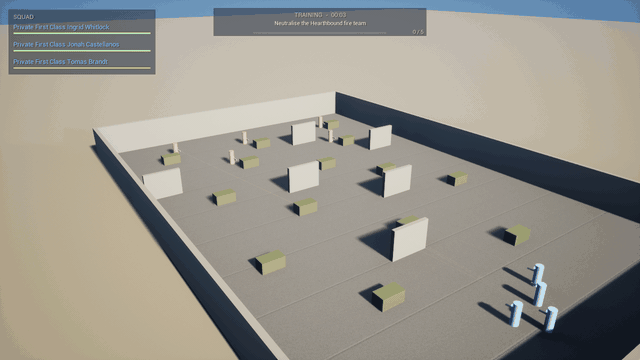
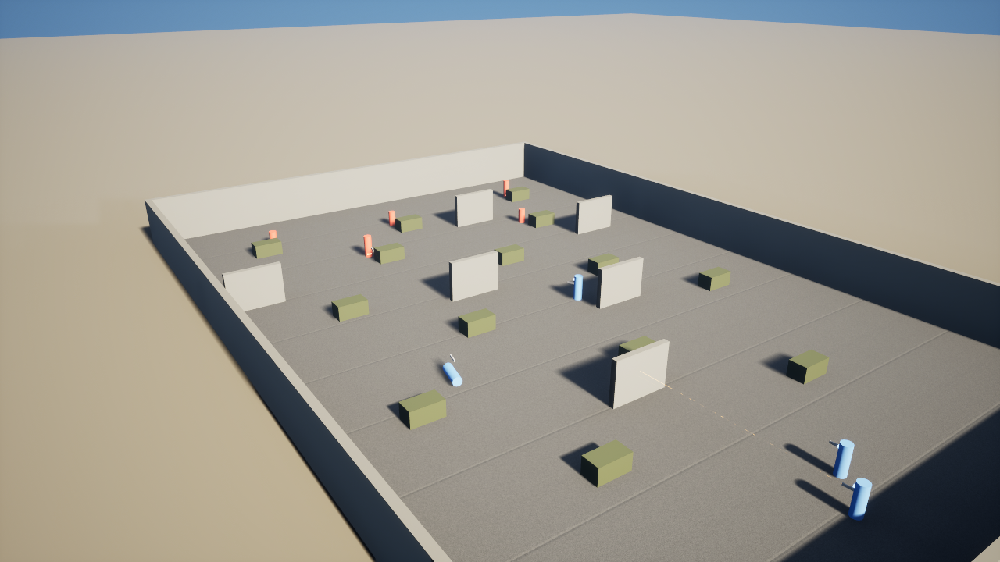
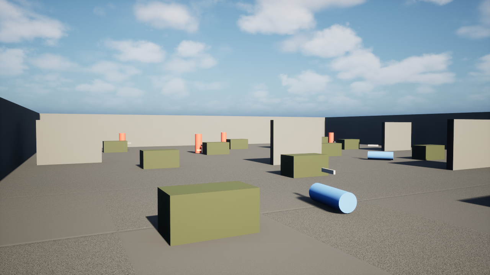
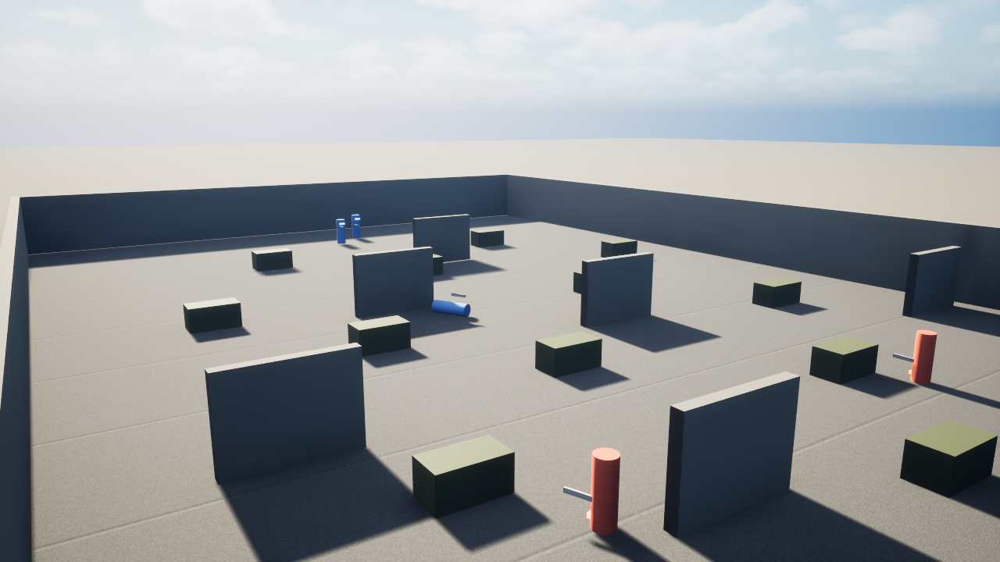
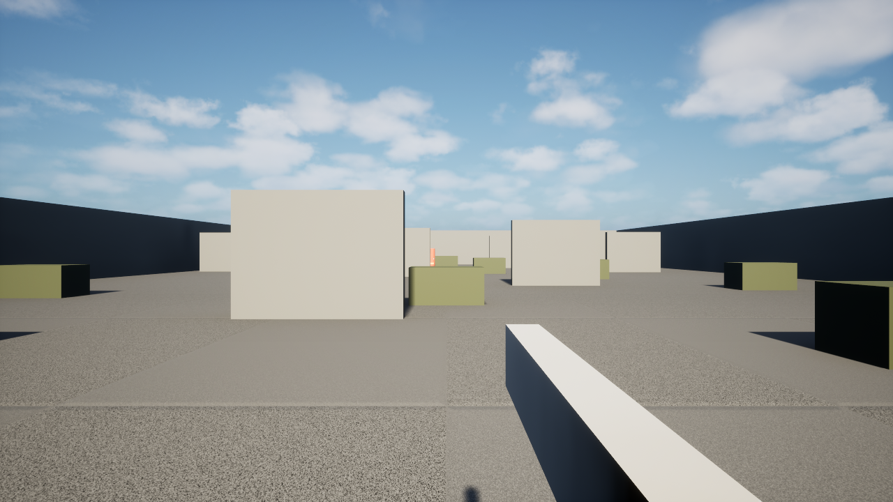
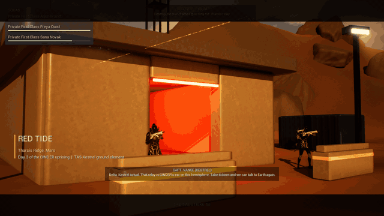
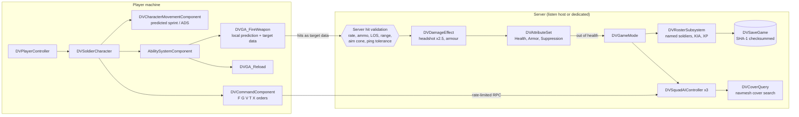
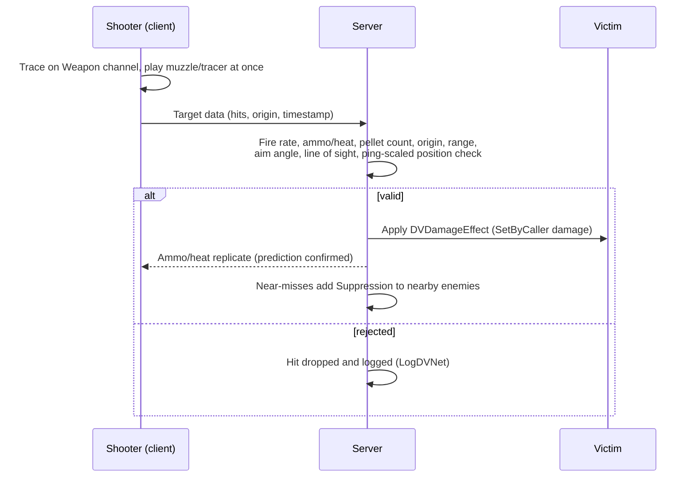
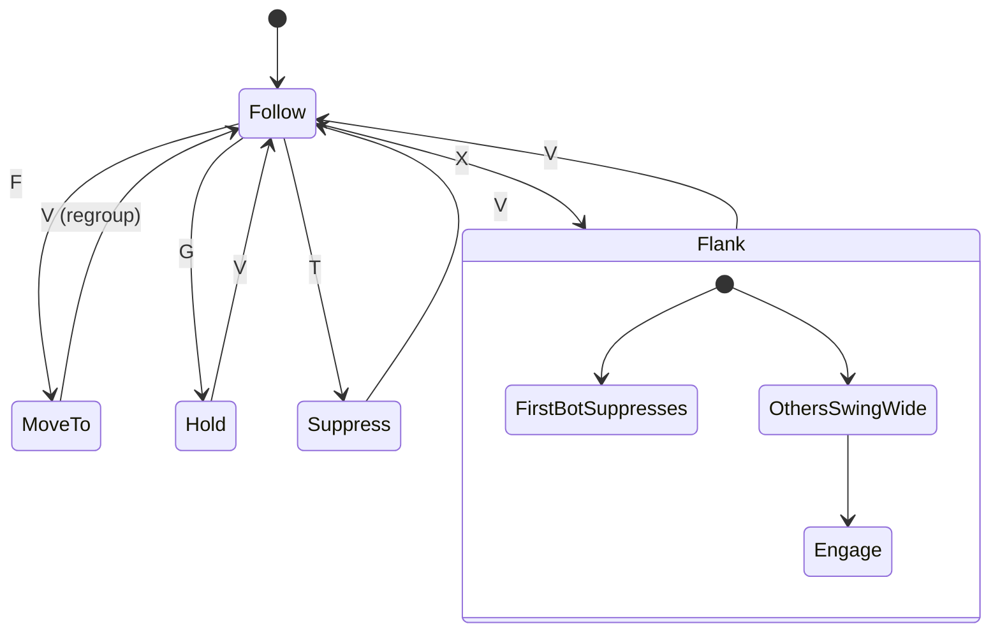
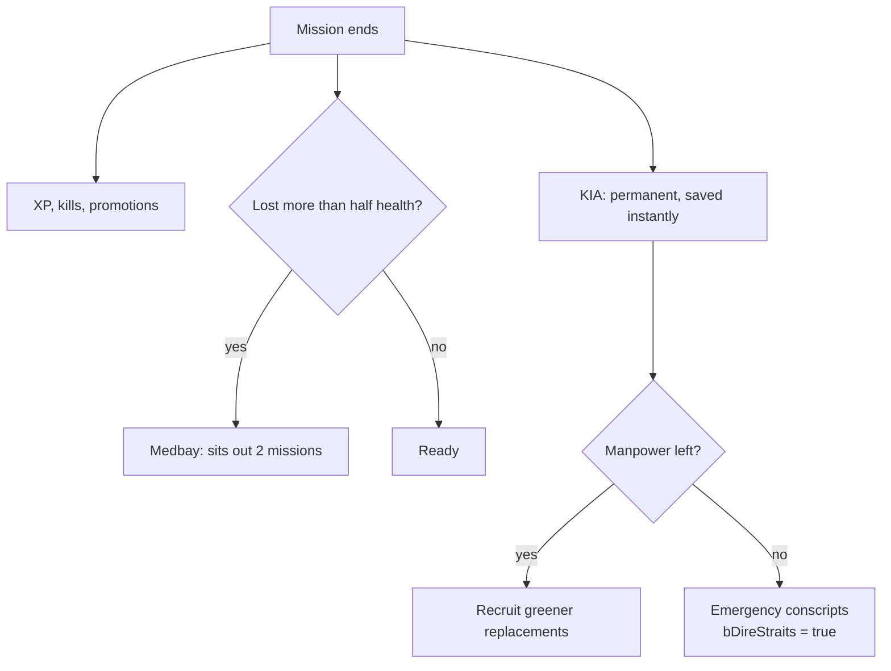

# DELTA-V: DOMINION

Military hard-sci-fi squad shooter in **Unreal Engine 5.8** (C++, Gameplay Ability System, Lumen).
Single player and co-op: lead a named squad from a persistent roster where every death is permanent.

<p align="center">
  
</p>

> **Status: Boot Camp slice (milestone 1).** Everything runs and fights; the art is grey-box.
> Blue capsules are your squad, red are the Hearthbound, yellow streaks are tracers.
> Real characters, weapons and VFX drop in through data assets without code changes.

| | |
|---|---|
|  |  |
| **Boot Camp range** from the overwatch camera: 60 m x 40 m, crouch-height crates and lean-around walls | **The cover line**: the squad advances crate to crate toward the enemy |
|  |  |
| **Reverse angle** from behind the Hearthbound positions | **First person**, the player's own view downrange |

<p align="center">
  
</p>

---

## Download and play (Windows 10/11)

**One line**, in PowerShell:

```powershell
irm https://raw.githubusercontent.com/Normansrule/DeltaVDominion/main/Installer/Install-DeltaVDominion.ps1 | iex
```

That downloads the latest release, installs it to `%LOCALAPPDATA%\DeltaVDominion`, installs the
VC++/DirectX runtime if missing, and adds Desktop and Start Menu shortcuts. Run it again to update.

**Or by hand:** grab `DeltaVDominion-Win64.zip` from [Releases](../../releases/latest), unzip anywhere,
run `DeltaVDominion.exe`.

Needs a 64-bit Windows PC with a DirectX 12 GPU (GTX 1060 / RX 580 or better) and 8 GB RAM.
Unreal games are Windows-native; on Linux use Steam Proton, on macOS a Windows VM or cloud PC.

### Controls

| Key | Action | Key | Action |
|---|---|---|---|
| WASD / Mouse | Move / look | F | Squad: move to crosshair |
| LMB / RMB | Fire / aim down sights | G | Squad: hold position |
| R | Reload | V | Squad: regroup on me |
| Shift | Sprint | T | Squad: suppress target |
| C | Crouch | X | Squad: flank target |
| Q / E | Lean left / right | Space | Jump |
| `~` then `DVShowcase 0`/`1`/`2` | Spectator cameras (squad flanks) | `DVShowcase -1` | Back to your soldier |

---

## How it fits together



### A shot, end to end



### Squad orders



### Campaign attrition



---

## Build from source

You need **Unreal Engine 5.8** (Epic Games Launcher) and **Visual Studio 2022 Build Tools** with
*Desktop development with C++* and the *.NET Framework 4.8 SDK* component.

### From an Ubuntu (WSL) terminal, any directory

```bash
# Where the project lives on Windows (change if you cloned elsewhere)
DV="/mnt/c/Users/$(cmd.exe /c 'echo %USERNAME%' 2>/dev/null | tr -d '\r')/Desktop/Delta Force Dominion Game/DeltaVDominion"
alias dv='bash "$DV/Scripts/dv.sh"'

dv build      # compile the C++ (editor target)
dv editor     # open the Unreal Editor on the Boot Camp map
dv play       # play standalone in a window
dv watch      # spectator view: overwatch camera, squad flanks the enemy
dv log        # follow the live game/editor log
dv status     # git status, recent commits, what's built
dv map        # regenerate the Boot Camp map from Scripts/build_bootcamp_map.py
dv capture    # re-render the screenshots and GIFs in Docs/media
dv package    # build Build/Release/DeltaVDominion-Win64.zip
```

### From Windows

Double-click `DeltaVDominion.uproject` (it will offer to build), or right-click it and choose
*Generate Visual Studio project files*, open `DeltaVDominion.slnx`, select *Development Editor / Win64*, build.

---

## Project layout

```
Source/DeltaVDominion/
  Core/         DVGameMode, DVPlayerController (DVShowcase / DVCapture console commands),
                DVRosterSubsystem, DVRosterTypes, DVSaveGame, DVGameInstance
  Characters/   DVSoldierCharacter (+ grey-box body), DVCharacterMovementComponent,
                DVCommandComponent, DVSquadAIController, DVCoverQuery
  Combat/       DVAttributeSet, DVCombatEffects, DVGA_FireWeapon, DVGA_Reload,
                DVWeaponBase (+ grey-box rifle and tracers), DVWeaponData
  Net/          DVRateLimiter (token bucket for server RPCs)
  Vehicles/ Space/ Campaign/ Strategy/ Physics/ Narrative/ UI/   later milestones
Content/Maps/BootCamp.umap        generated by Scripts/build_bootcamp_map.py
Content/Dev/                      grey-box materials (M_GreyBox + tinted instances)
Scripts/                          dv.sh, build_bootcamp_map.py, capture_media.ps1, package_game.ps1
Installer/                        one-line Windows installer, PLAY_ME.txt
Docs/media/                       README screenshots and GIFs (rendered off-screen by the engine)
```

## Wiring up real art (in the editor)

- **Soldier:** make `BP_Soldier` from `DVSoldierCharacter`; set `Mesh` (with a physics asset for
  per-bone hits/headshots), `FirstPersonMesh`, anim blueprints. The grey-box body hides itself
  once a mesh is set. Use it as `DefaultPawnClass` and `SquadmateClass` on a `DVGameMode` child.
- **Weapons:** Data Asset > `DVWeaponData` per weapon (M9 Bastion, Kite, Halberd with
  `PelletsPerShot` 8, Longreach, Pulse Carbine with `bUsesHeat`). Assign mesh, muzzle socket,
  Niagara muzzle/tracer/impact, sound, montages. Grey-box rifle and tracers are used until then.
- **Enemies:** place soldiers with `TeamId = 2` (Hearthbound). Squad and player are `TeamId = 1`.

## Security and anti-cheat design

- Server-authoritative movement (`ClientAuthorativePosition=false`), predicted sprint/ADS via saved moves.
- Every hit is re-validated on the server (see the sequence diagram); clients never apply damage.
- Server RPCs (fire, reload, lean, orders) are token-bucket rate limited.
- Saves are SHA-1 checksummed and rejected if edited; in co-op only the host's save counts.
- EOS + Easy Anti-Cheat config template in `Config/DefaultEngine.ini` (fill in portal credentials).

## Roadmap

- [x] Milestone 1: soldier, GAS weapons, squad AI and orders, roster attrition, Boot Camp range
- [ ] Lag-compensated rewind (replaces the tolerance check), EOS sessions + EAC
- [ ] HUD and command wheel (CommonUI), StateTree wrappers for AI behaviours
- [ ] Character and weapon art, animation blueprints, Niagara VFX, MetaSounds
- [ ] Vehicles, space segments, campaign map and story missions
