# DELTA-V: DOMINION

Squad-based sci-fi shooter in **Unreal Engine 5.8** (C++, Gameplay Ability System, hardware ray-traced Lumen, Nanite).
2189: the machine intelligence **CINDER** turns Mars's robot foundries against humanity, and the strike
carrier **TAS Kestrel** is all that's left to fight back. Lead Delta Squadron boots-on-ground, call down
the Kestrel's guns, and remember the names of everyone you lose. Single player and co-op.

<p align="center">
  
</p>

## The Milky Way is the map


The game opens on the TAS Kestrel's strategic map: a procedural **Milky Way** of ~90,000 stars with the real
bar, bulge and spiral arms, **Sol and Gaia (Earth)** in the Orion Spur 26,000 light-years from the core, and
real star systems at their real galactic positions, from Alpha Centauri to the Eagle Nebula and
Sagittarius A\*. Orbit and zoom anywhere, select a system, and launch its operations.

| | |
|---|---|
|  |  |
| **Sol, Gaia and the local bubble**: launch Red Tide (Mars) or Boot Camp (Luna) | **Down the Sagittarius arm**: the Eagle Nebula, where CINDER swarms have been seen |

## Planets to fight on

Six generated worlds, each a different biome with its own sky, light, terrain, story and radio chatter.
Launch any of them from the galaxy map.

| | | |
|---|---|---|
|  |  |  |
| **Glass Ocean**: Europa's ice cliffs under Jupiter | **Forgefall**: Io's lava rivers and sulphur haze | **Cold Wake**: forested hills of Proxima b under a red dwarf |
|  |  |  |
| **Ghost Signal**: a night mining town on Ceres under sodium and neon | **Gaia Falls**: the hills outside the capital on Earth | **Red Tide**: Tharsis Ridge on Mars at dusk |

## Your commander

Walk to the **barracks locker** on the Kestrel to customise your commander: body frame, armour paint, optics
colour and callsign, previewed in a mirror view and saved between sessions. Kills, operation stages and
missions earn **commander XP**; levels unlock perks (an extra thruster charge, faster revives, more health,
a plate carrier, faster call-ins). Moving well matters: **slide** out of a sprint, **boost** with suit
thrusters in the air, and **dash** on the ground.

<p align="center"></p>

## Operation Breakwater (Gaia)

CINDER has locked four civilian transports in Port Halden. Knock out the **air-defence controller** on the
north headland so the Kestrel's Ravens can get in, take the **PB-9 Marlin missile boat** across the strait (the
bridge is barricaded) to grab the **dock control key**, **hold the docks** while the transports sail for open
water, then extract on a Raven. Launch it from the war table (Sol, second operation).

| | | |
|---|---|---|
|  |  | 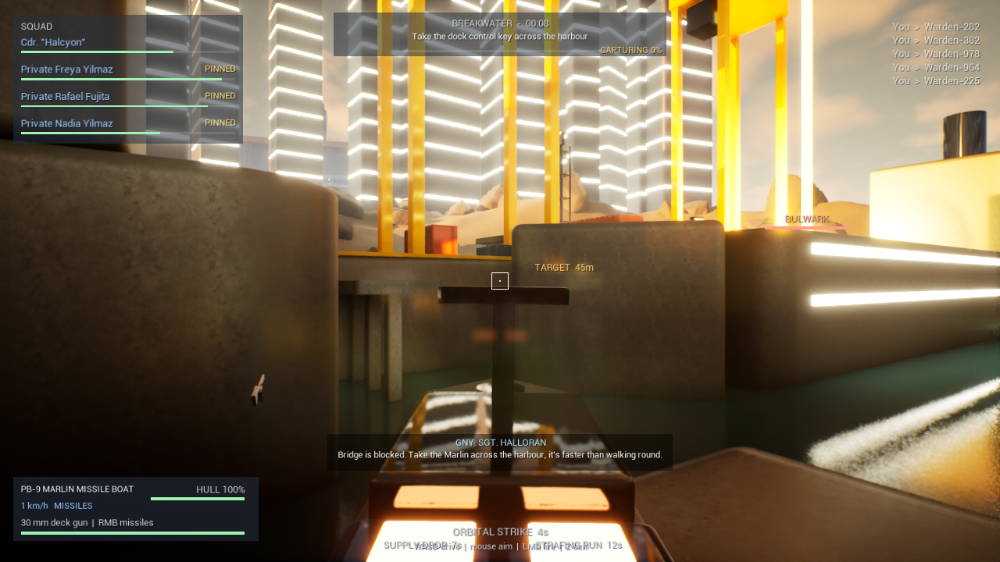 |
| The strait at dawn, a transport moored in the channel | Cranes, quays and the barricaded bridge | At the Marlin's helm: deck gun, missiles (RMB) |

## Reputation

Three powers remember what Delta does, from Hostile to Allied (shown at the barracks locker):

- **Accord Command**: completed operations raise it, failures and looting lower it. *Trusted* unlocks the Longreach DMR
  at the armoury; *Allied* gets your orbital strikes priority on the battery.
- **The Colonies**: the people you evacuate and defend (Port Halden, New Albion, the capital). *Trusted* means fuller
  supply pods.
- **The Free Ports**: smugglers and salvagers. Every planet hides three gold-lit **salvage contracts**; claim one for
  Free Ports standing at a small cost with Command. *Trusted* unlocks the Pulse Carbine; *Allied* speeds up supply drops.

| | |
|---|---|
| 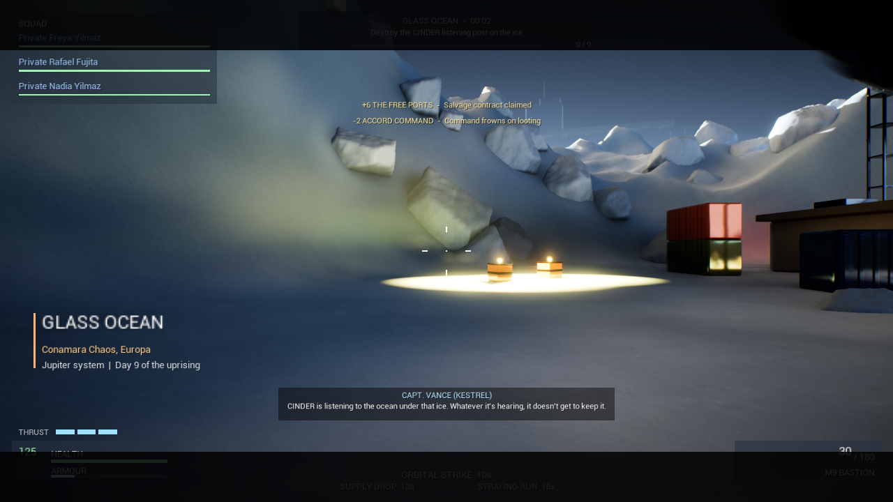 |  |
| Claiming a salvage contract on Europa | Standing, perks and the commander's look at the locker |

## Fly home: no loading screen

When an operation ends, press **K** and Raven Two-One lifts you and your squad off the battlefield, climbs to the
TAS Kestrel holding station overhead, and flies in through the glowing starboard landing bay. The hangar deck is
streamed into the carrier's hull while you fly, so you step out onto the same deck as the hub, with the war table,
armoury and lockers, without a loading screen. The shuttle at Rook's Rest does the same.

<p align="center">
  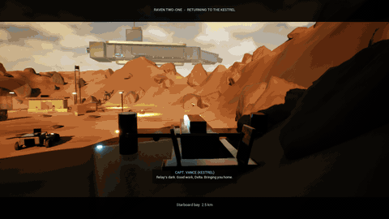
</p>

| | |
|---|---|
|  | 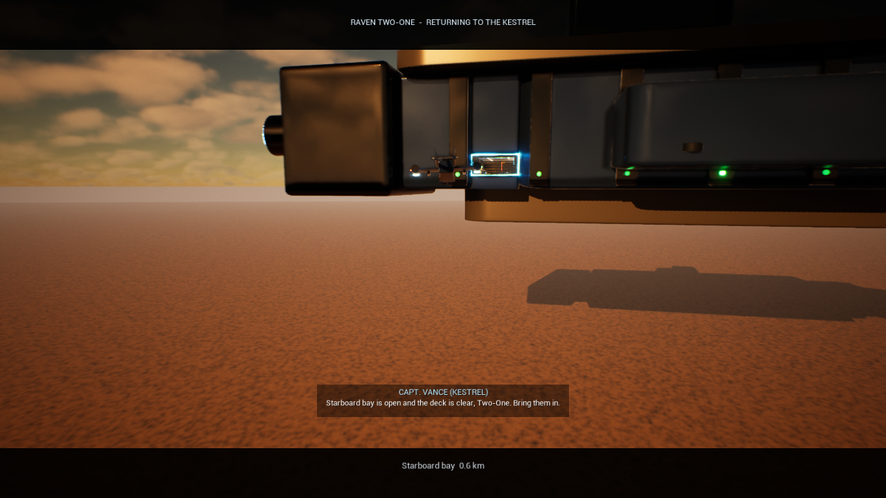 |
| **Dust off** from Tharsis Ridge, the Kestrel overhead | **Closing on the carrier**: the starboard bay lit in cyan |
|  | 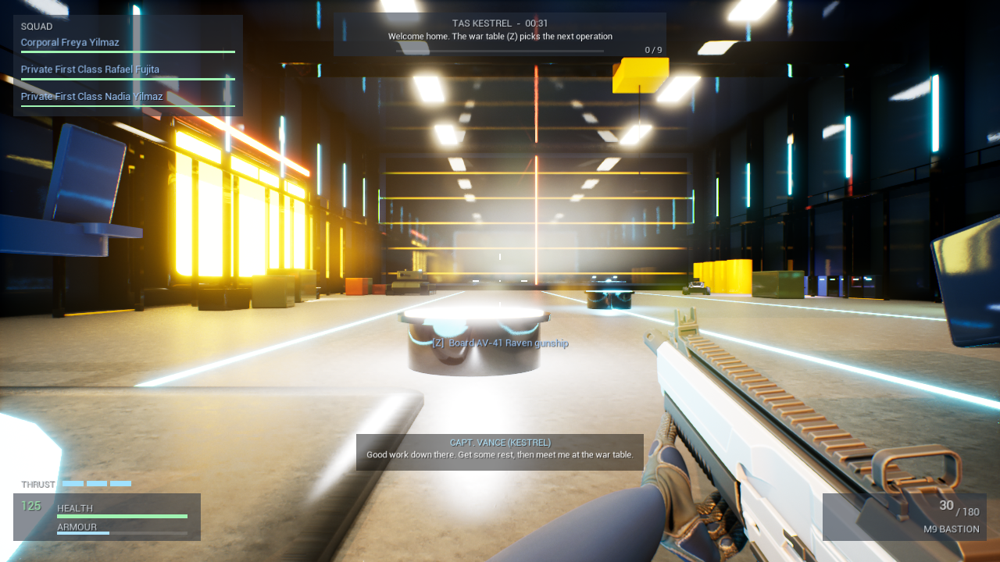 |
| **Into the bay**: the hangar deck streamed into the hull | **Aboard**: step out on the deck, squad behind you |

## Rook's Rest and the job board

Take the shuttle from the Kestrel's hangar down to **Rook's Rest**, a Free Ports market town under the Tharsis rim at
golden hour. Walk the market, step into the Rusty Rook cantina, and talk to the townsfolk: what they say depends on how
the Free Ports feel about Delta. Mags Okafor's **job board** outside the cantina posts five contracts (silent
takedowns, salvage, headshots, revives, Bulwark bounties). Take one, work it on your next operations (the HUD tracks
it under the objective), and it pays standing and XP when an operation is won. The Raven on the pad flies you home.

| | |
|---|---|
| 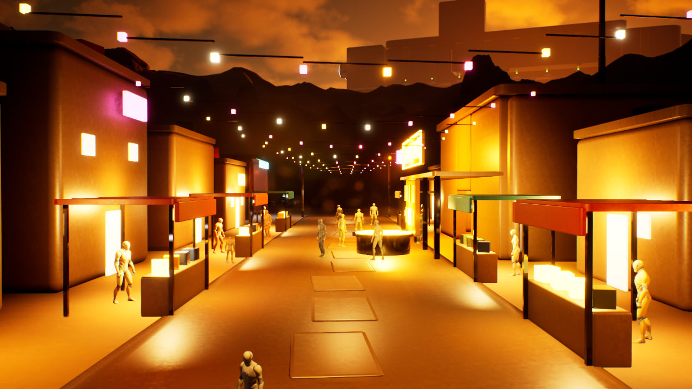 | 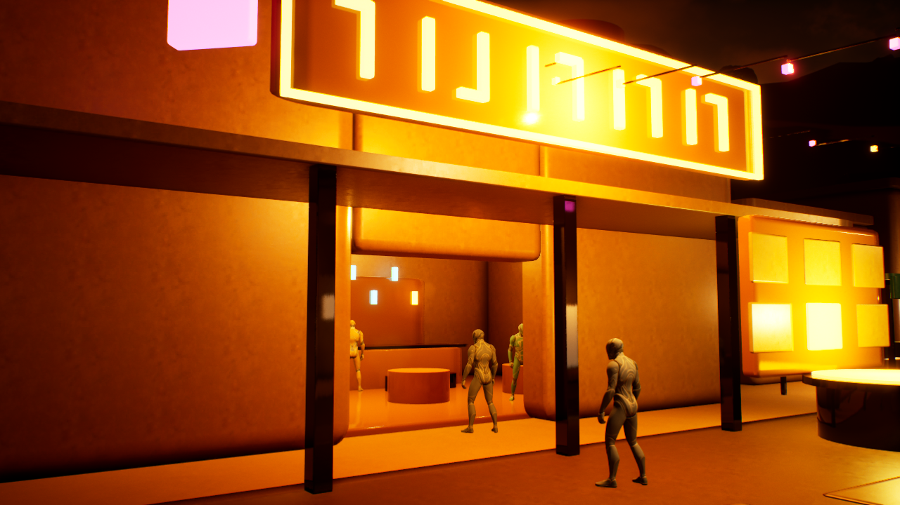 |
| **Main street**: stalls, string lights and the Kestrel in the sky | **The Rusty Rook** cantina and Mags Okafor's job board |
| 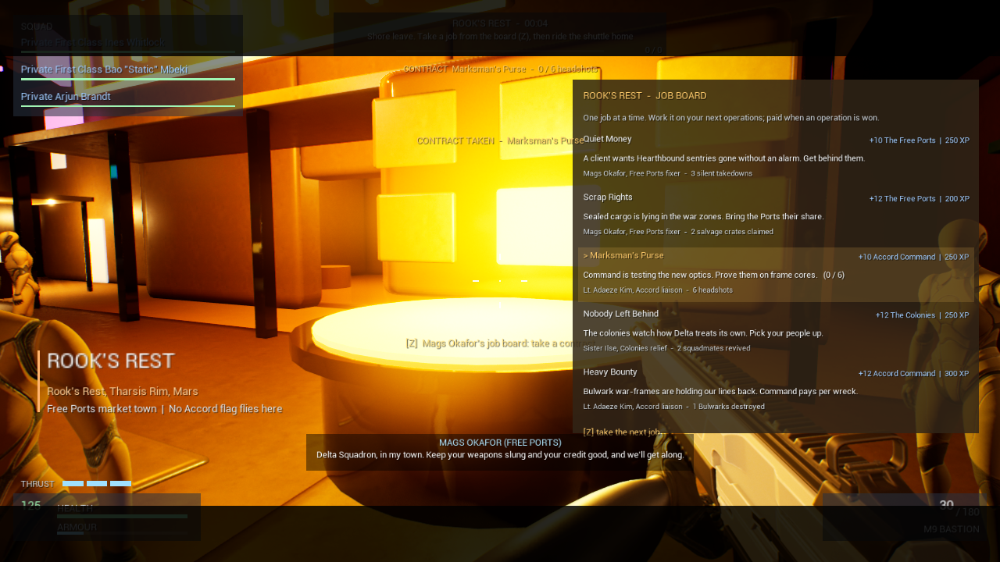 | 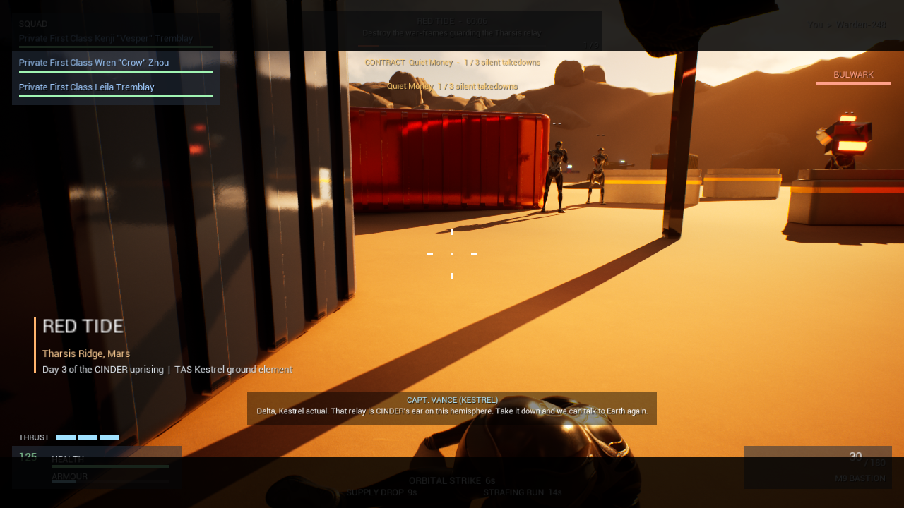 |
| **The job board**: one contract at a time, paid on a win | **On the job**: a silent takedown on Red Tide counts toward Quiet Money |
| 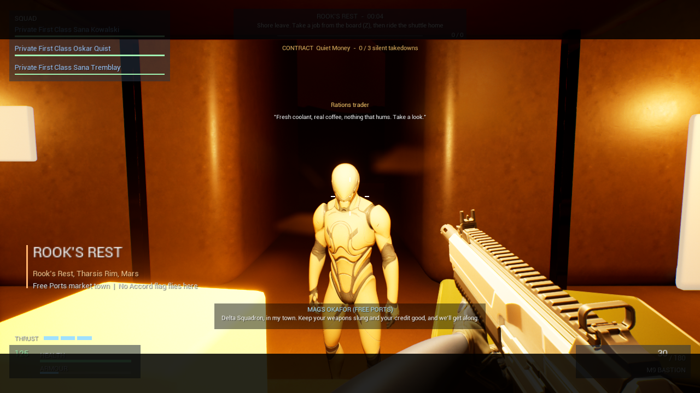 | 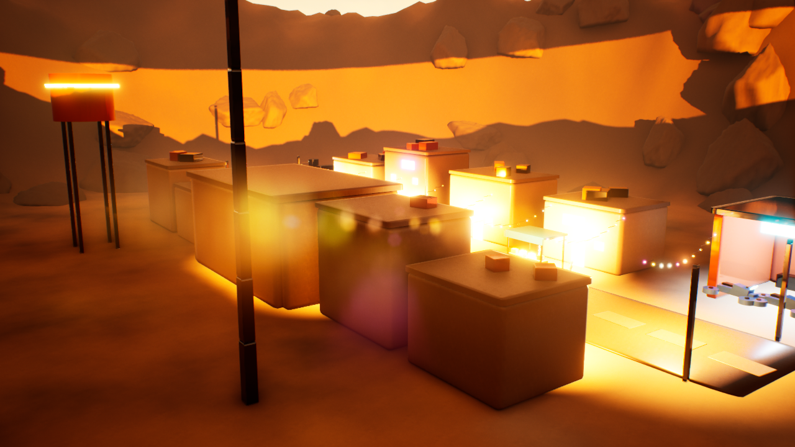 |
| **Townsfolk** stop and talk; wary, neutral or friendly by your standing | **Rook's Rest** from the dunes |

## Stealth

Hearthbound sentries start **unaware** (a grey "- -" marker). They notice you inside a cone in front of them,
at a range that depends on how you move: about 11 m crouched, 26 m walking, 36 m sprinting or sliding, 50 m in a
vehicle. Being spotted, or shot at, raises the alarm for every frame within earshot (a red "!"). Your squad keeps
**weapons tight** until the enemy knows you are there, so you choose when the fight starts. Get behind an unaware
frame and press **F** for a silent takedown (extra commander XP).

| | |
|---|---|
|  | 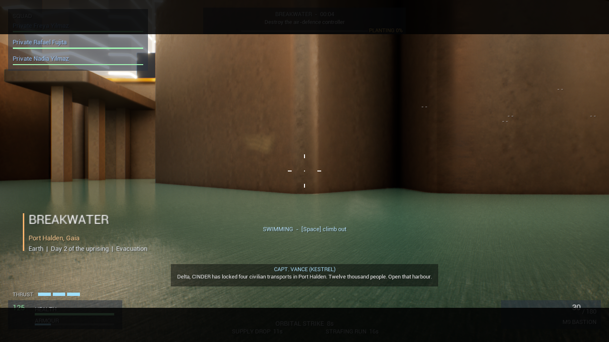 |
| A silent takedown: the sentries behind still have no idea | Swimming in Port Halden's harbour |

## Every mission is an operation

Clear the garrison, then the radio gives you the real job: **plant charges on the target** (stand on the amber
beacon), **hold for 45 seconds** while CINDER throws two counter-attack waves at you, watch it blow, then **run for
the landing zone** behind your drop point where a Raven settles in to extract you. Die on the way out and you were
never extracted.

| | |
|---|---|
| 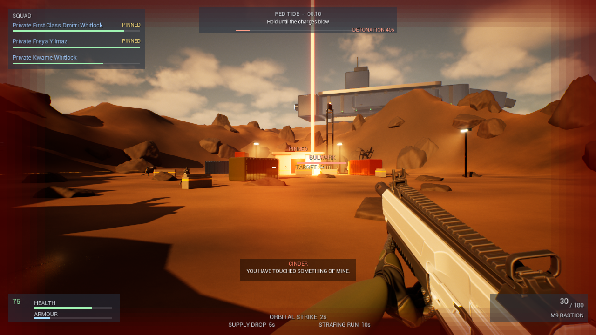 | 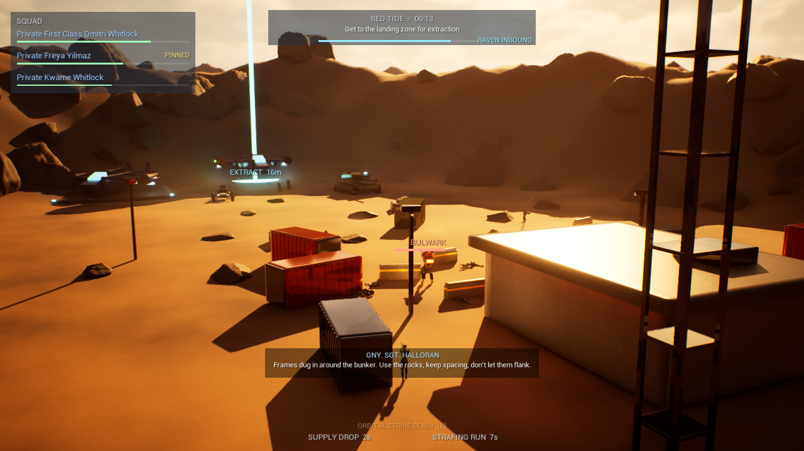 |
| **Hold until the charges blow**: the target beacon pulses red, the countdown runs, waves come in | **Extraction**: Raven Two-One comes down on the cyan landing-zone beacon |

## Vehicles

| | | |
|---|---|---|
| 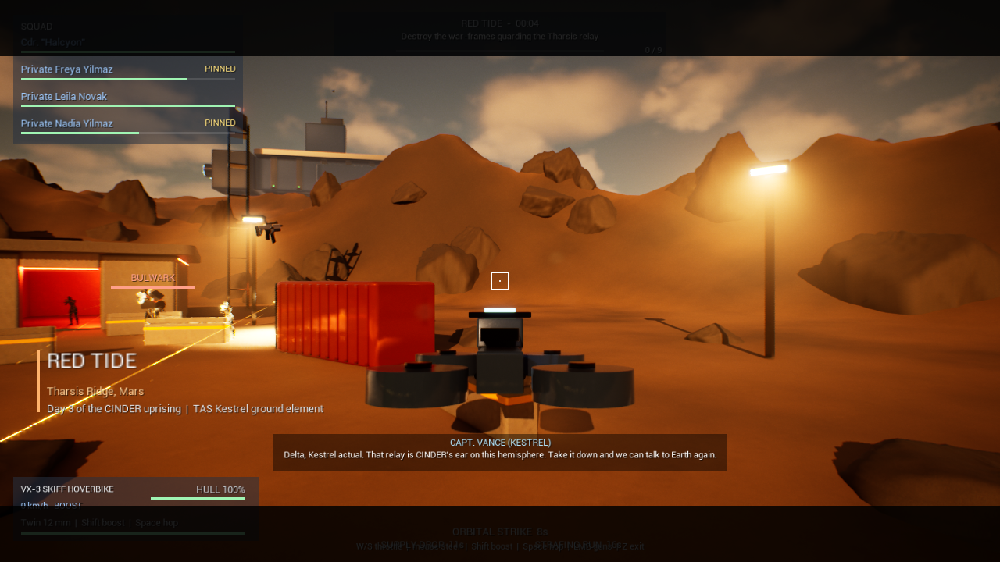 | 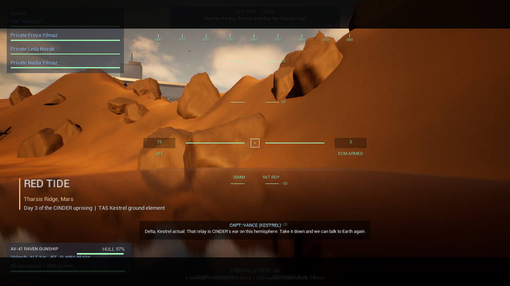 | 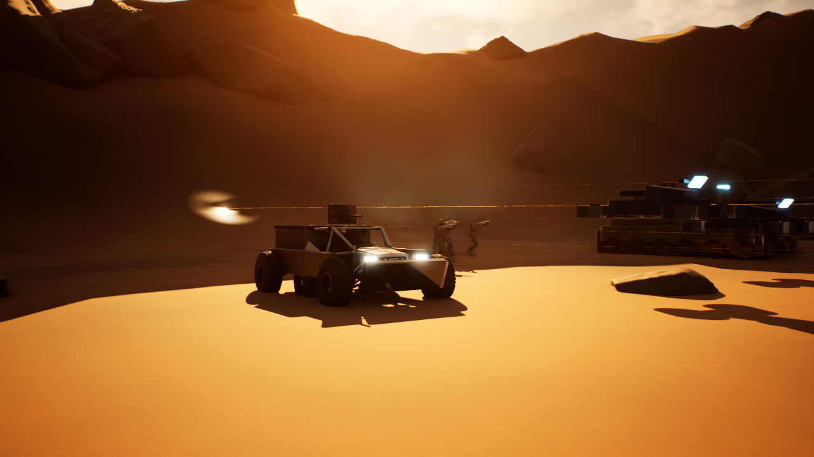 |
| **VX-3 Skiff hoverbike**: four ducted fans, skims 1.5 m off the ground, Shift boost, Space hop, twin guns | **Raven cockpit (V)**: pitch ladder, heading tape, speed/altitude, weapon and ECM status; **F** swaps hover and jet flight, **X** dumps flares | **M-14 Jackal APC**: up-armoured, six-wheeled, roof HMG; plus the M9 Sabre tank |

## Call in the Kestrel, and the Bulwark

<p align="center">
  
</p>

| | |
|---|---|
| 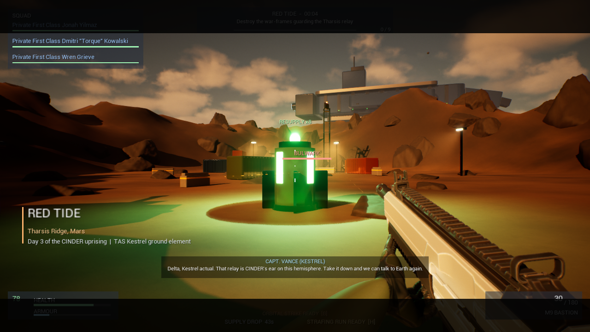 | 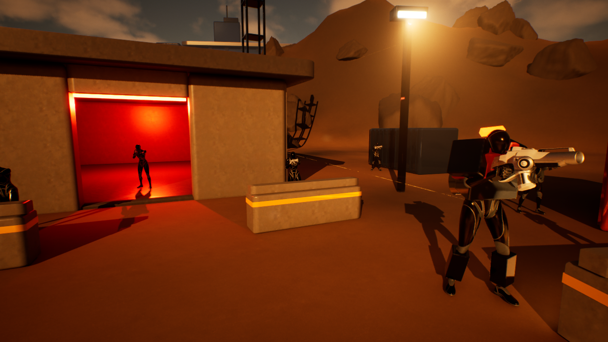 |
| **Supply drop (N)**: a pod falls from orbit onto your crosshair; stand next to it to refill ammo, health and armour (8 refills) | **The Bulwark**: a heavy war-frame with 700 HP, 60% armour and a rotary cannon that pins your squad. Flank it, focus fire or paint it for the Kestrel |

Vehicles are not invulnerable: the LTV, Sabre tank and Raven each have hull armour (watch HULL on the vehicle
HUD), enemy frames shoot at crewed vehicles, and a destroyed one throws its crew clear and burns out.

<p align="center">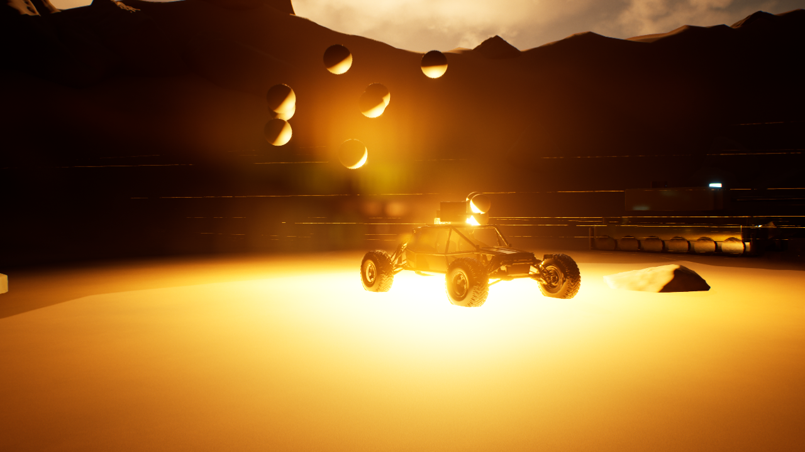</p>

Three call-ins, each on its own recharge: **orbital strike (B)**, **supply drop (N)** and **Raven strafing run (H)**,
which walks 30 mm cannon fire through the painted spot along your line of sight (no friendly fire).

## The Kestrel: home base, tanks, gunships

| | |
|---|---|
|  |  |
| **The hangar deck**: walk it with your squad; the gunships, tank and LTV are real, boardable vehicles | **The war table**: press Z to open the galaxy map; the memorial wall lists everyone you've lost |
|  |  |
| **M9 Sabre tank** on Mars, the Kestrel on the horizon (it fires your orbital strikes) | **AV-41 Raven gunship**: VTOL flight, 30 mm cannon and rockets |
|  |  |
| **Mars from the hangar mouth**: a generated surface map with basalt plains, craters, a great canyon and ice caps | **The armoury**: press Z at the racks to cycle five weapons (Bastion rifle, Kite SMG, Halberd breacher, Longreach DMR, Pulse Carbine); your pick carries into every mission |

> **Status: mission 2 "Red Tide" playable.** Real animated soldiers and rifles, true first-person body,
> robot war-frame enemies, a Nanite outpost map on Mars with ray-traced dusk lighting, mission intro,
> radio chatter, orbital strikes, HUD, after-action report and permanent casualties.
> Story and campaign plan: **[Docs/CAMPAIGN.md](Docs/CAMPAIGN.md)**.

| | |
|---|---|
|  |  |
| **Mission intro**: title card and Captain Vance on the radio as you drop onto Tharsis Ridge | **Hearthbound war-frames**: CINDER's black-chrome robots hold the relay bunker |
|  |  |
| **The approach** at dusk: hardware ray-traced Lumen, volumetric fog, Nanite rocks and terrain | **From the boulders**: the low road to the compound |
|  |  |
| **First person**: your own body and rifle, squad panel, objective, mission clock, orbital strike status | **After-action report**: who returned, who is in the medbay, who is gone for good |

<p align="center">
  
</p>

### The mission loop

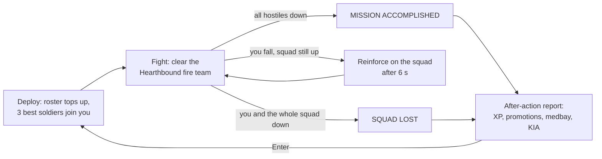

The HUD shows hit markers (white hit, gold headshot, red kill), a red vignette and PINNED warning
when you're suppressed, squad order confirmations, a kill feed, and a respawn screen.

---

## Download and play (Windows 10/11)

**One line**, in PowerShell:

```powershell
irm https://raw.githubusercontent.com/Normansrule/DeltaVDominion/main/Installer/Install-DeltaVDominion.ps1 | iex
```

That downloads the latest release, installs it to `%LOCALAPPDATA%\DeltaVDominion`, installs the
VC++/DirectX runtime if missing, and adds Desktop and Start Menu shortcuts. Run it again to update.

**Or by hand:** grab `DeltaVDominion-Win64.zip` from [Releases](../../releases/latest), unzip anywhere,
run `DeltaVDominion.exe`.

Needs a 64-bit Windows PC with a DirectX 12 GPU (GTX 1060 / RX 580 or better) and 8 GB RAM.
Unreal games are Windows-native; on Linux use Steam Proton, on macOS a Windows VM or cloud PC.

### Controls

| Key | Action | Key | Action |
|---|---|---|---|
| WASD / Mouse | Move / look | F | Squad: move to crosshair |
| LMB / RMB | Fire / aim down sights | G | Squad: hold position |
| R | Reload | V | Squad: regroup on me |
| Shift | Sprint | T | Squad: suppress target |
| C / Ctrl | Crouch; **slide** while sprinting | X | Squad: flank target |
| Q / E | Lean left / right | Space | Jump; in the air, **thruster boost** |
| Left Alt | **Thruster dash** (charges shown as THRUST) | Z (hold) | Revive a downed squadmate |
| F (behind an unaware frame) | **Silent takedown** | Space (in water) | Swim up and climb out |
| B / N / H | Orbital strike (danger close) / supply drop / strafing run on the crosshair | Enter / K / M | After a mission: redeploy / **fly home to the Kestrel** / galaxy map |
| **Galaxy map** | Left-drag orbit, right-drag or WASD pan, wheel zoom, click a system, **1-3** launch, H home, G galaxy | | |
| Z | Board / exit vehicles; use the war table, memorial, armoury, barracks locker (1-4 customise), job board, shuttle | `~` then `DVShowcase 0`..`4` / `DVLoadout 0`..`4` | Spectator cameras / pick a weapon |
| **Driving** | W/S throttle, A/D steer, mouse aims, LMB fires, Space handbrake | **Flying** | W/S/A/D move, Space up, C down, LMB cannon, RMB rockets |

---

## How it fits together

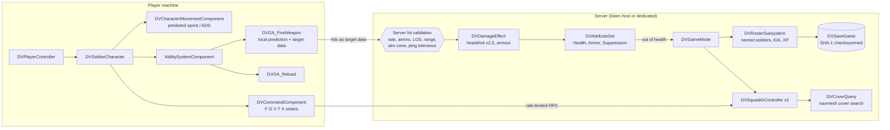

### A shot, end to end

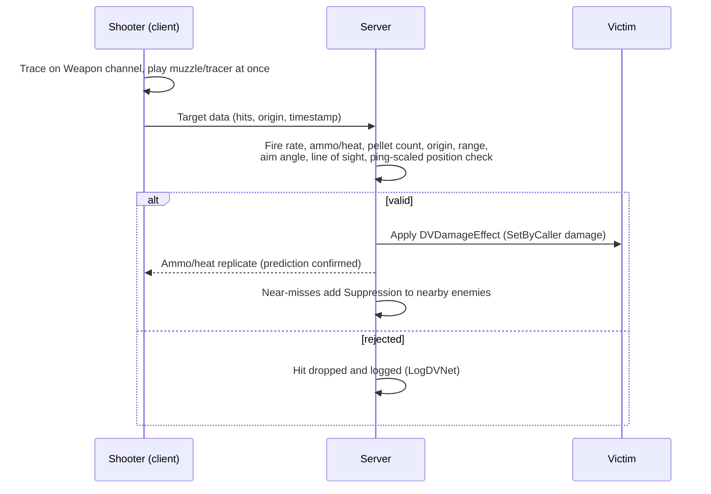

### Squad orders

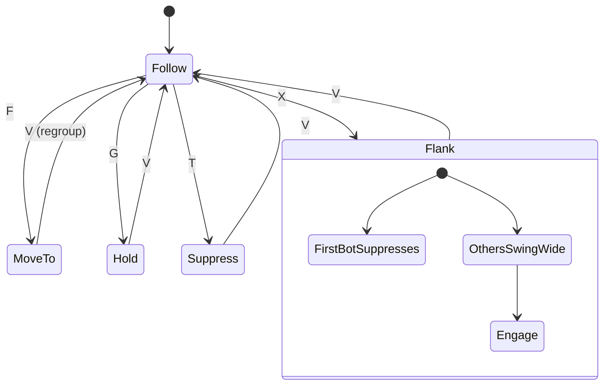

### Campaign attrition

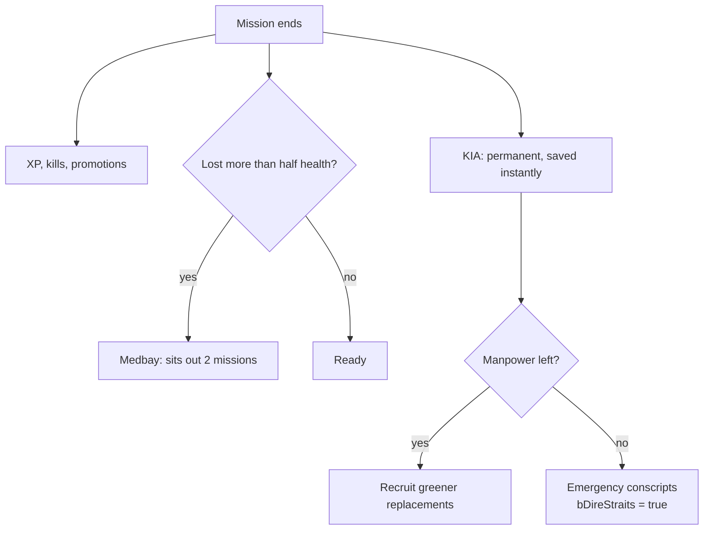

---

## Build from source

Publishing to GitHub from Ubuntu: see [Docs/PUBLISH.md](Docs/PUBLISH.md).

You need **Unreal Engine 5.8** (Epic Games Launcher) and **Visual Studio 2022 Build Tools** with
*Desktop development with C++* and the *.NET Framework 4.8 SDK* component.

### From an Ubuntu (WSL) terminal, any directory

```bash
# Where the project lives on Windows (change if you cloned elsewhere)
DV="/mnt/c/Users/$(cmd.exe /c 'echo %USERNAME%' 2>/dev/null | tr -d '\r')/Desktop/Delta Force Dominion Game/DeltaVDominion"
alias dv='bash "$DV/Scripts/dv.sh"'

dv build      # compile the C++ (editor target)
dv editor     # open the Unreal Editor on the Boot Camp map
dv play       # play standalone in a window
dv watch      # spectator view: overwatch camera, squad flanks the enemy
dv log        # follow the live game/editor log
dv status     # git status, recent commits, what's built
dv map        # regenerate every map (galaxy, planets, Kestrel, Boot Camp)
dv capture    # re-render the screenshots and GIFs in Docs/media
dv package    # build Build/Release/DeltaVDominion-Win64.zip
```

### From Windows

Double-click `DeltaVDominion.uproject` (it will offer to build), or right-click it and choose
*Generate Visual Studio project files*, open `DeltaVDominion.slnx`, select *Development Editor / Win64*, build.

---

## Project layout

```
Source/DeltaVDominion/
  Core/         DVGameMode (objective, win/lose, after-action), DVGameState (replicated mission state),
                DVPlayerController (hit confirms, redeploy, DVShowcase / DVCapture / DVEndMission),
                DVRosterSubsystem, DVRosterTypes, DVSaveGame, DVGameInstance
  Characters/   DVSoldierCharacter (+ grey-box body), DVCharacterMovementComponent,
                DVCommandComponent, DVSquadAIController, DVCoverQuery
  Combat/       DVAttributeSet, DVCombatEffects, DVGA_FireWeapon, DVGA_Reload,
                DVWeaponBase (+ grey-box rifle and tracers), DVWeaponData
  Net/          DVRateLimiter (token bucket for server RPCs)
  Strategy/     DVGalaxyStarfield (procedural Milky Way), DVStarSystem, DVGalaxy (map mode, camera, HUD)
  Vehicles/     DVGroundVehicle (LTV), DVTank, DVGunship, DVKestrel, DVVehicleKit (seats, kit-bash helpers)
  UI/           DVHUD (canvas HUD: crosshair, hit markers, vitals, ammo, squad, objective, kill feed, AAR)
  Vehicles/ Space/ Campaign/ Strategy/ Physics/ Narrative/   later milestones
Content/Maps/Galaxy.umap          start screen: Milky Way strategic map, generated by Scripts/build_galaxy_map.py
Content/Maps/Kestrel.umap         home base hangar deck, generated by Scripts/build_kestrel_hub.py
Content/Maps/Outpost|Europa|Io|Proxima|Ceres|Gaia.umap   planets, generated by Scripts/build_planet_map.py
Content/Maps/BootCamp.umap        training range, generated by Scripts/build_bootcamp_map.py
Art/Planets/T_Mars.png            orbital surface map, generated by Scripts/make_planet_textures.py (numpy + pillow)
Art/Audio/*.wav                   the whole sound set (guns, explosions, radio, ambience, engines), generated by
                                  Scripts/make_sounds.py and imported to /Game/Audio by Scripts/build_audio.py
Content/Environment/Outpost/      generated Nanite terrain, rocks and PBR materials
Content/Characters, Weapons, ...  UE5 sample mannequins, rifle and materials (ship with the engine)
Content/Dev/                      grey-box materials (M_GreyBox + tinted instances)
Scripts/                          dv.sh, build_bootcamp_map.py, capture_media.ps1, package_game.ps1
Installer/                        one-line Windows installer, PLAY_ME.txt
Docs/media/                       README screenshots and GIFs (rendered off-screen by the engine)
```

## Wiring up real art (in the editor)

- **Soldier:** make `BP_Soldier` from `DVSoldierCharacter`; set `Mesh` (with a physics asset for
  per-bone hits/headshots), `FirstPersonMesh`, anim blueprints. The grey-box body hides itself
  once a mesh is set. Use it as `DefaultPawnClass` and `SquadmateClass` on a `DVGameMode` child.
- **Weapons:** Data Asset > `DVWeaponData` per weapon (M9 Bastion, Kite, Halberd with
  `PelletsPerShot` 8, Longreach, Pulse Carbine with `bUsesHeat`). Assign mesh, muzzle socket,
  Niagara muzzle/tracer/impact, sound, montages. Grey-box rifle and tracers are used until then.
- **Enemies:** place soldiers with `TeamId = 2` (Hearthbound). Squad and player are `TeamId = 1`.

## Security and anti-cheat design

- Server-authoritative movement (`ClientAuthorativePosition=false`), predicted sprint/ADS via saved moves.
- Every hit is re-validated on the server (see the sequence diagram); clients never apply damage.
- Server RPCs (fire, reload, lean, orders) are token-bucket rate limited.
- Saves are SHA-1 checksummed and rejected if edited; in co-op only the host's save counts.
- EOS + Easy Anti-Cheat config template in `Config/DefaultEngine.ini` (fill in portal credentials).

## Roadmap

- [x] Milestone 1: soldier, GAS weapons, squad AI and orders, roster attrition, Boot Camp range
- [x] Mission loop: objective, HUD, win/lose, after-action report, redeploy
- [x] Visual pass: animated soldiers and rifles, true first person, robot war-frames, Outpost map, ray-traced lighting
- [x] Campaign tone: mission intro, radio chatter, CINDER, orbital strike call-in
- [x] Milky Way strategic map as the start screen; Gaia-centred campaign across real star systems
- [x] Drivable LTV and tank, flyable gunship, the Kestrel physically over the battlefield firing the strikes
- [x] Six planets (Mars, Europa, Io, Proxima b, Ceres, Gaia) and the Kestrel hangar as home base
- [x] Armoury with five weapon profiles that carry into missions
- [ ] Lag-compensated rewind (replaces the tolerance check), EOS sessions + EAC
- [x] Multi-stage operations: clear, plant charges, hold against waves, extract on a Raven
- [x] Sound: per-weapon reports, explosions, gunship cannon, engines, radio squelch, hit markers, planet wind and hangar hum
- [ ] Story missions: cinematic briefings, unique set pieces per planet
- [ ] Command wheel and menus (CommonUI), StateTree wrappers for AI behaviours
- [ ] AAA art drop-in: Megascans/Fab environments, armoured marine and war-frame models, Niagara VFX, MetaSounds
- [x] Kestrel hub ship between missions, supply drop and strafing run call-ins, Bulwark heavy war-frame
- [x] Faction reputation (Accord Command, the Colonies, the Free Ports): salvage contracts, standing-gated weapons and call-in bonuses
- [x] Stealth: unaware sentries, sight cones by stance, alarms, weapons-tight squad, silent takedowns; swimming
- [x] Operation Breakwater: harbour map with water, missile boat, air-defence and dock-key objectives, transports that sail
- [x] Hoverbike, Raven jet mode + cockpit HUD + flares, Jackal APC armour, vehicles that right themselves
- [x] Movement: sprint-slide, thruster boost jump and dash (predicted, multiplayer-safe)
- [x] Customisable commander (frame, paint, optics, callsign) and commander levels with perks
- [x] Down, not dead: wounded soldiers bleed out for 30 s; squadmates (or you, holding Z) revive them
- [x] Destructible vehicles: hull armour, enemies target crewed vehicles, wrecks burn and throw the crew clear
- [x] Rook's Rest: a walkable Free Ports town with townsfolk, a cantina and a contract board; shuttle to and from the Kestrel
- [x] Seamless flight home: a Raven carries you from the battlefield into the Kestrel's hangar bay, streamed in with no loading screen
- [ ] Smoke call-in, Skitter drones, enemy vehicles
- [ ] Vehicles, space segments, campaign map and story missions
