<h1 align="center">DELTA-V: DOMINION</h1>

<p align="center">
  <b>Bring your people home.</b><br>
  A squad-based sci-fi shooter in <b>Unreal Engine 5.8</b>: C++, Gameplay Ability System, hardware ray-traced Lumen, Nanite.
</p>

<p align="center">
  <a href="../../releases/latest"></a>
  
  
</p>

<p align="center">
  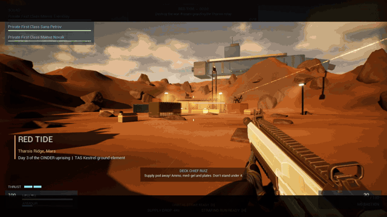
</p>

In 2189 the machine intelligence **CINDER** turns Mars's robot foundries against humanity. The strike carrier
**TAS Kestrel** is what's left to fight back. Lead Delta Squadron on the ground, call down the Kestrel's guns,
fly your people home, and remember the names of everyone you lose. Single player, with co-op built in (see
[where it stands](#where-it-stands-v022)).

Everything in the GIFs and screenshots below was captured from the game itself, rendered off-screen by the
engine. There are no mock-ups and no pre-rendered cinematics.

**Contents:**
- [Download](#download-and-play-windows-1011)
- [Progress tracker](#progress-tracker) and [roadmap](#roadmap)
- [Where it stands](#where-it-stands-v022)
- Milestones:
  - [Boot Camp](#1-boot-camp)
  - [Red Tide](#2-red-tide-the-first-operation)
  - [The galaxy](#3-the-milky-way-is-the-map)
  - [Vehicles and the Kestrel](#4-vehicles-and-the-kestrel)
  - [Breakwater](#5-operation-breakwater)
  - [Your commander and reputation](#6-your-commander-and-reputation)
  - [Rook's Rest](#7-rooks-rest-a-town-between-operations)
  - [Fly home](#8-fly-home-no-loading-screen)
  - [The Kestrel remembers](#9-the-kestrel-remembers)
  - [The Ironstride walker](#10-the-ironstride-walker)
- [Controls](#controls)
- [Build from source](#build-from-source)

---

## Download and play (Windows 10/11)

**[Download the latest release](../../releases/latest)** (`DeltaVDominion-Win64.zip`, about 550 MB). Unzip it anywhere and
run `DeltaVDominion.exe`.

Or install with one line in PowerShell. This downloads the latest release to `%LOCALAPPDATA%\DeltaVDominion`, adds
shortcuts, and updates if you run it again:

```powershell
irm https://raw.githubusercontent.com/Normansrule/delta-v-dominion/main/Installer/Install-DeltaVDominion.ps1 | iex
```

You need a 64-bit Windows PC with a DirectX 12 GPU (GTX 1060 / RX 580 or better) and 8 GB of RAM. On Linux, use Steam
Proton. On a Mac, use a Windows VM or a cloud PC.

---

## Progress tracker

<p align="center"></p>

The percentages are judged against the plan in [Docs/CAMPAIGN.md](Docs/CAMPAIGN.md), not against a finished AAA game.
They're updated at each milestone with `python Scripts/make_progress_bars.py`.

| Area | Progress | What's built | What's left |
|---|---|---|---|
| Combat and squad |  | GAS weapons, server-checked hits, 3 AI squadmates and orders, revive, stealth, movement kit | Lag-compensated rewind, command wheel |
| Missions and maps |  | 8 operations on planet maps plus Boot Camp, including Ironstride; multi-stage objectives | The rest of the campaign's maps |
| Vehicles |  | Tank, LTV, APC, hoverbike, Raven (hover/jet), Marlin boat, the Kestrel, the Ironstride walker | A space fighter; AI pilots and drivers |
| Kestrel hub |  | Hangar, war table, armoury, lockers, memorial; fly home with no loading screen; the hangar remembers | Launching from the Kestrel to orbit; talking with the crew |
| Towns and factions |  | Rook's Rest, 3 factions with standing, 5 contracts, townsfolk | Towns on Brasshaven, Neon Verge and Hollyhock Vale; more factions |
| Co-op |  | Server-authoritative design, replicated combat and vehicles | Not yet played over two machines; sessions, EOS, Easy Anti-Cheat |
| Art and audio |  | Kit-bashed geometry, UE5 mannequins, generated materials and sounds | Real character, vehicle and environment art; music |
| Campaign and story |  | Story bible, mission intros, radio chatter, Acts I and II settings | Cinematics, Acts III and IV, the Static virus arc |

## Roadmap

- [x] Boot Camp, Red Tide and the mission loop
- [x] The galaxy map and six planets
- [x] Vehicles, call-ins, the Bulwark
- [x] Stealth, movement and the downed state
- [x] Operation Breakwater
- [x] The commander, reputation and contracts
- [x] Rook's Rest
- [x] Fly home with no loading screen
- [x] The Kestrel remembers
- [x] The Ironstride walker: board a moving giant, overload its couplings, ride it down
- [ ] Launch from the Kestrel to orbit and the galaxy map
- [ ] Co-op played and tested over two machines
- [ ] Brasshaven (steampunk), Neon Verge (cyberpunk), Hollyhock Vale (non-lethal)
- [ ] Story missions with cinematic briefings
- [ ] Real art pass: characters, war-frames, vehicles, environments, music

## Where it stands (v0.22)

Each entry was played in the packaged Windows build unless it says otherwise.

### Done

| Area | Details |
|---|---|
| Core combat | First-person shooting on the Gameplay Ability System with server-checked hits, 5 weapons, headshots, armour, suppression |
| Squad | 3 AI squadmates with orders (move, hold, regroup, suppress, flank), cover search, revive |
| Casualties | Named soldiers; downed state with 30 s bleed-out; permanent KIA; medbay; replacements |
| Operations | Clear, plant charges, hold against waves, extract on a Raven; scripted objectives on Breakwater |
| Call-ins | Orbital strike from the Kestrel, supply pod, Raven strafing run |
| Stealth | Sight cones by stance, alarms, a weapons-tight squad, silent takedowns, swimming |
| Movement | Sprint-slide, thruster boost and dash (predicted, multiplayer-safe) |
| Vehicles | Tank, LTV, Jackal APC, hoverbike, Raven gunship (hover/jet, cockpit, flares), Marlin missile boat, the boardable Ironstride walker; hull damage and wrecks |
| Worlds | Galaxy map, 8 planet maps, Boot Camp range, the Kestrel hangar, Rook's Rest town |
| Progression | Commander customisation, levels and perks; reputation with 3 factions; 5 town contracts |
| Hub | Fly home with no loading screen; a hangar that remembers losses, wounded, repairs, trophies and evacuees across reloads |

### Partial

| Area | What's missing |
|---|---|
| Co-op | The design is server-authoritative (listen host). It hasn't been played over two machines yet. The Kestrel's memory props show only for the host. |
| Art | Built from engine primitives, the UE5 mannequins and generated materials. The environments, characters and frames are placeholders for real art. |
| Audio | A generated placeholder sound set; no music yet |
| Anti-cheat | Server validation and save checksums are in. EOS and Easy Anti-Cheat are a config template only. |

### Planned

See the [roadmap](#roadmap).

The full campaign plan is in **[Docs/CAMPAIGN.md](Docs/CAMPAIGN.md)**.

---

## 1. Boot Camp

The training range on Luna, six weeks before the uprising. Learn the squad orders (F move, X flank, T suppress), the
orbital strike (B) and the movement kit against live-fire targets.

| | |
|---|---|
|  |  |
| **First person** on the range, with Gunnery Sergeant Halloran on the radio | **The range from above**: cover lanes and the target frames |

## 2. Red Tide: the first operation

Tharsis Ridge, Mars. CINDER's war-frames hold a relay bunker:
1. Clear the garrison.
2. Plant charges.
3. Hold for 45 seconds against two waves.
4. Run for the Raven at the landing zone.

<p align="center">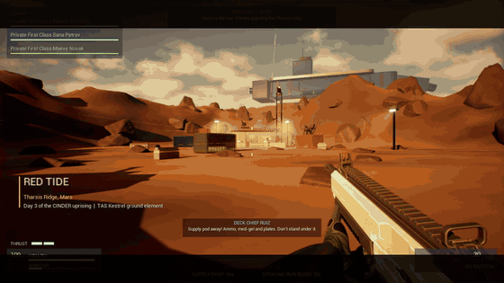</p>

| | |
|---|---|
|  |  |
| **Mission intro**: a title card, with Captain Vance on the radio | **Hearthbound war-frames** holding the relay bunker |
|  |  |
| **Hold** until the charges blow | **Extraction**: Raven Two-One sets down on the landing-zone beacon |
|  |  |
| **Stealth**: a silent takedown; the sentries behind still don't know | **After-action report**: who came back, who's in the medbay, who's gone |

Call in the Kestrel: an **orbital strike (B)**, a **supply drop (N)** or a **Raven strafing run (H)**. Watch out for the
**Bulwark**, a 700 HP heavy war-frame with a rotary cannon.

| | |
|---|---|
|  |  |
|  |  |

## 3. The Milky Way is the map

The game opens on the Kestrel's strategic map. It's a procedural Milky Way of about 90,000 stars with the real bar and
spiral arms. Sol and Gaia (Earth) sit in the Orion Spur, and real star systems are at their real positions. Pick a
system, then launch its operation.

| | |
|---|---|
|  |  |

| | | |
|---|---|---|
|  |  |  |
| **Glass Ocean**, Europa | **Forgefall**, Io | **Cold Wake**, Proxima b |
|  |  |  |
| **Ghost Signal**, Ceres | **Gaia Falls**, Earth | **Red Tide**, Mars |

<p align="center">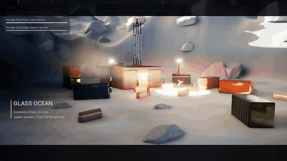</p>

## 4. Vehicles and the Kestrel

Every vehicle is real and boardable (Z). They have hull armour, enemies target crewed vehicles, and a destroyed
vehicle burns out and throws its crew clear.

| | |
|---|---|
|  | 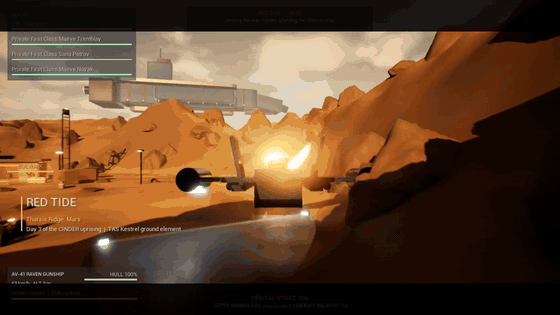 |
| **M9 Sabre tank** assaulting the bunker | **AV-41 Raven** gunship: hover and jet flight |
| 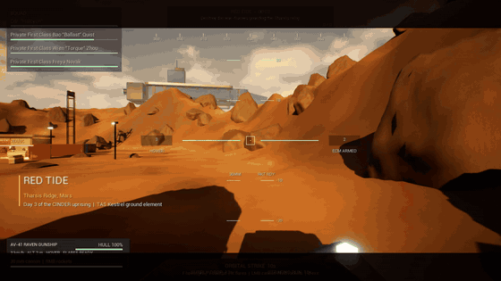 | 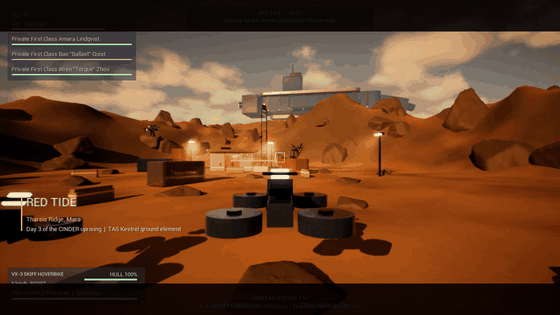 |
| **Raven cockpit (V)**: pitch ladder, heading, flares (X) | **VX-3 Skiff hoverbike**: boost and hop |

The **TAS Kestrel** hangar is home base: the war table, the armoury, the barracks lockers and the memorial wall.

<p align="center"></p>

| | |
|---|---|
|  |  |
|  |  |

## 5. Operation Breakwater

Gaia. CINDER has locked four civilian transports in Port Halden:
1. Knock out the air-defence site so the Ravens can get in.
2. Take the **PB-9 Marlin missile boat** across the strait for the dock key.
3. Hold the docks while the transports sail.
4. Extract.

<p align="center"></p>

| | | |
|---|---|---|
|  |  | 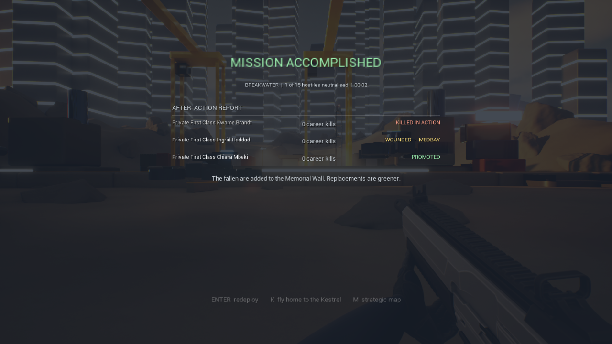 |
| The strait at dawn | Cranes, quays and the barricaded bridge | **Mission accomplished**, with one killed, one wounded and one promoted |

## 6. Your commander and reputation

At the barracks locker you set your commander's frame, paint, optics and callsign. XP earns levels and perks.
Three powers remember what you do: **Accord Command**, **the Colonies** and **the Free Ports**. Their standing gates
weapons and call-in bonuses. Every planet hides three salvage contracts for the Free Ports.

| | | |
|---|---|---|
|  |  |  |

## 7. Rook's Rest: a town between operations

A Free Ports market town on the Tharsis rim at golden hour, one shuttle ride from the hangar. Townsfolk wander and
talk to you differently depending on your standing. Mags Okafor's job board posts contracts that you work on your
next operations, and they pay when you win.

<p align="center">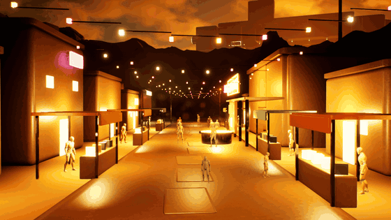</p>

| | |
|---|---|
|  |  |
|  |  |

## 8. Fly home: no loading screen

After an operation, press **K**. Raven Two-One lifts the squad off the battlefield, flies to the Kestrel holding
station overhead, and lands through the starboard bay. The hangar streams into the hull during the flight.

<p align="center"></p>

| | |
|---|---|
|  |  |

## 9. The Kestrel remembers

The hangar deck shows what your operations cost and won, and it survives quitting and reloading:
- name plates and candles for the fallen, and their lockers sealed;
- the wounded in medbay beds;
- deck crew welding a damaged Raven;
- Bulwark trophies;
- evacuees on the deck;
- a light per operation on the ops board.

Test report: **[Docs/TEST_REPORT_KESTREL_REMEMBERS.md](Docs/TEST_REPORT_KESTREL_REMEMBERS.md)**.

| | | |
|---|---|---|
| 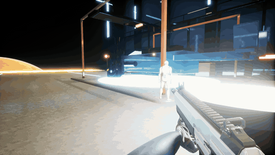 |  |  |
| Deck crew welding the Raven | The medbay after Breakwater | Candles under the memorial wall |
|  | 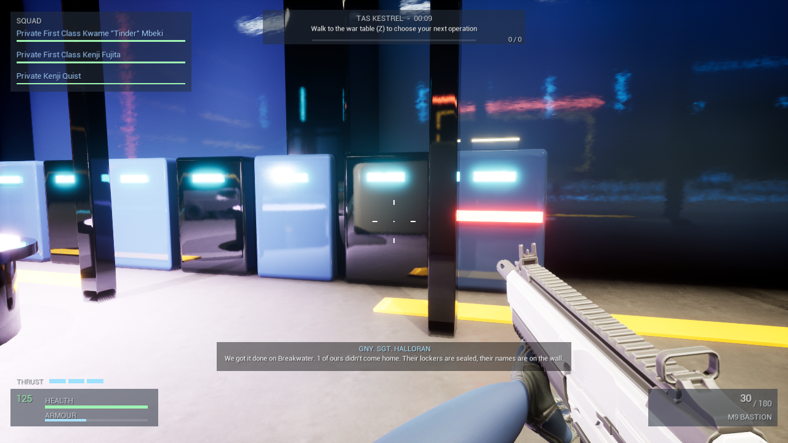 | 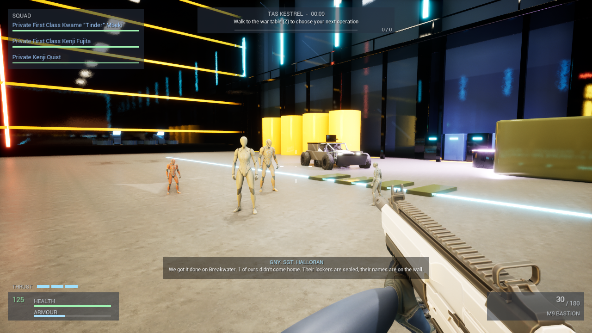 |

## 10. The Ironstride walker

Arcadia Planitia, Mars. A 30 m Hearthbound walker carries a foundry core across the plain:
1. Wait for it to kneel.
2. Run up the rear ramp and ride its back.
3. Stand at each of its three power couplings until they blow.
4. Hold on when it comes down, then extract.

Its four legs really step. Its cannon marks the ground in red two seconds before the shell lands. Miss the kneel or
fall off, and it comes around and kneels again.

Test report: **[Docs/TEST_REPORT_IRONSTRIDE.md](Docs/TEST_REPORT_IRONSTRIDE.md)**.

| | |
|---|---|
| 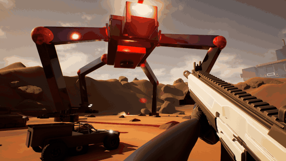 | 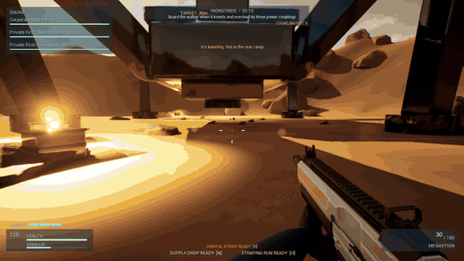 |
| The walker striding past, legs stepping on the terrain | Up the ramp, onto its back, overloading the couplings |
|  | 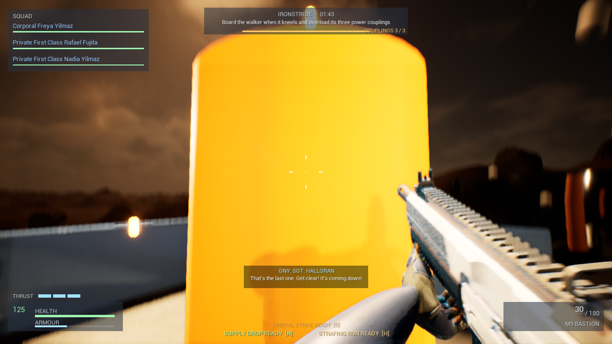 |
| Kneeling with the ramp down: board now | The last coupling blows |

---

## Controls

| Key | Action | Key | Action |
|---|---|---|---|
| WASD / Mouse | Move / look | F | Squad: move to crosshair (behind an unaware frame: **silent takedown**) |
| LMB / RMB | Fire / aim down sights | G / V | Squad: hold / regroup on me |
| R | Reload | T / X | Squad: suppress / flank target |
| Shift | Sprint | Space | Jump; in the air, **thruster boost**; in water, swim up |
| C / Ctrl | Crouch; **slide** while sprinting | Left Alt | **Thruster dash** |
| Q / E | Lean left / right | Z | Use or board; hold to revive a squadmate |
| B / N / H | Orbital strike / supply drop / strafing run | Enter / K / M | After a mission: redeploy / **fly home** / galaxy map |
| **Galaxy map** | Drag to orbit, wheel to zoom, click a system, 1-3 to launch | **Locker** | 1-4 customise your commander |
| **Driving** | W/S throttle, A/D steer, LMB fire | **Flying** | WASD move, Space up, C down, F jet mode, V cockpit, X flares |

---

## How it fits together

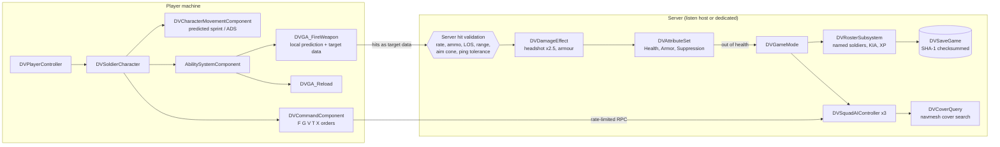

### A shot, end to end

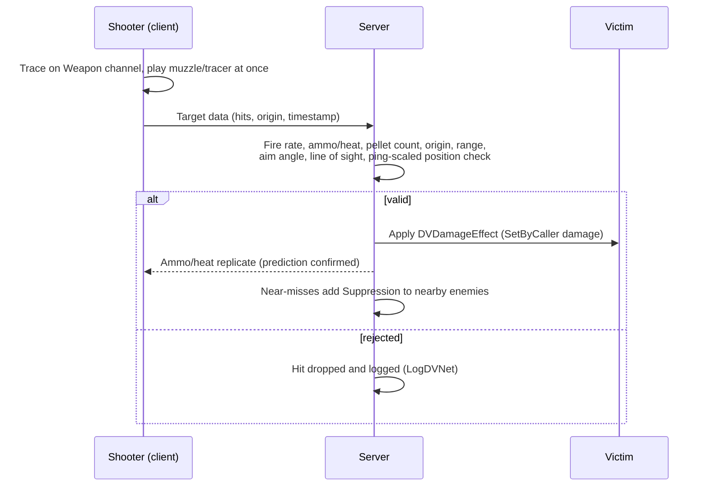

### Squad orders

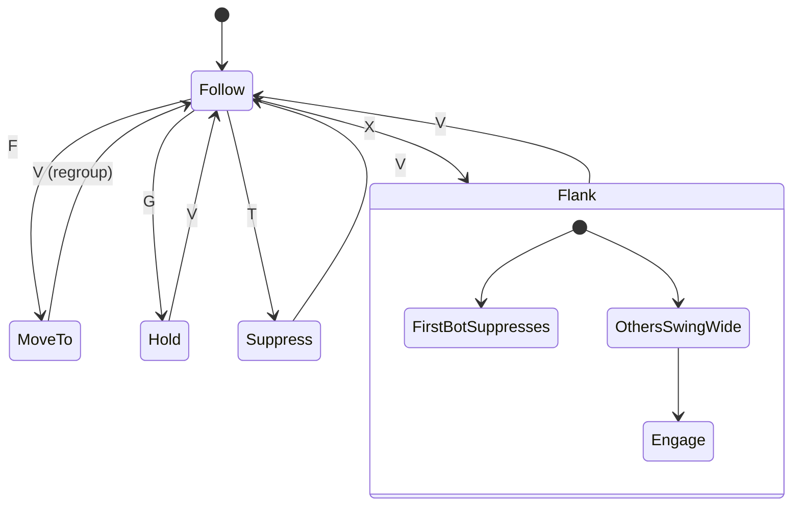

### Campaign attrition

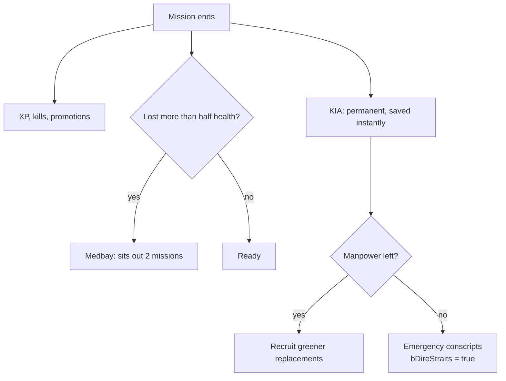

---

## Build from source

Publishing to GitHub from Ubuntu: see [Docs/PUBLISH.md](Docs/PUBLISH.md).

You need **Unreal Engine 5.8** (Epic Games Launcher) and **Visual Studio 2022 Build Tools** with
*Desktop development with C++* and the *.NET Framework 4.8 SDK* component.

### From an Ubuntu (WSL) terminal, any directory

```bash
# Where the project lives on Windows (change if you cloned elsewhere)
DV="/mnt/c/Users/$(cmd.exe /c 'echo %USERNAME%' 2>/dev/null | tr -d '\r')/Desktop/Delta Force Dominion Game/DeltaVDominion"
alias dv='bash "$DV/Scripts/dv.sh"'

dv build      # compile the C++ (editor target)
dv editor     # open the Unreal Editor on the Boot Camp map
dv play       # play standalone in a window
dv watch      # spectator view: overwatch camera, squad flanks the enemy
dv log        # follow the live game/editor log
dv status     # git status, recent commits, what's built
dv map        # regenerate every map (galaxy, planets, Kestrel, Boot Camp)
dv capture    # re-render the screenshots and GIFs in Docs/media
dv package    # build Build/Release/DeltaVDominion-Win64.zip
```

### From Windows

Double-click `DeltaVDominion.uproject` (it will offer to build), or right-click it and choose
*Generate Visual Studio project files*, open `DeltaVDominion.slnx`, select *Development Editor / Win64*, build.

---

## Project layout

```
Source/DeltaVDominion/
  Core/         DVGameMode (objective, win/lose, after-action), DVGameState (replicated mission state),
                DVPlayerController (hit confirms, redeploy, DVShowcase / DVCapture / DVEndMission),
                DVRosterSubsystem, DVRosterTypes, DVSaveGame, DVGameInstance
  Characters/   DVSoldierCharacter (+ grey-box body), DVCharacterMovementComponent,
                DVCommandComponent, DVSquadAIController, DVCoverQuery
  Combat/       DVAttributeSet, DVCombatEffects, DVGA_FireWeapon, DVGA_Reload,
                DVWeaponBase (+ grey-box rifle and tracers), DVWeaponData
  Net/          DVRateLimiter (token bucket for server RPCs)
  Strategy/     DVGalaxyStarfield (procedural Milky Way), DVStarSystem, DVGalaxy (map mode, camera, HUD)
  Vehicles/     DVGroundVehicle (LTV, tank, APC), DVGunship, DVHoverbike, DVBoat, DVKestrel, DVVehicleKit (seats, kit-bash helpers)
  UI/           DVHUD (canvas HUD: crosshair, hit markers, vitals, ammo, squad, objective, kill feed, AAR)
  Core/DVAscent      the flight home (streams the hangar into the Kestrel), Core/DVKestrelMemory (the hangar remembers)
  Characters/DVTownsfolk   townsfolk, crew, patients and evacuees
Content/Maps/Galaxy.umap          start screen: Milky Way strategic map, generated by Scripts/build_galaxy_map.py
Content/Maps/Kestrel.umap         home base hangar deck, generated by Scripts/build_kestrel_hub.py
Content/Maps/Outpost|Europa|Io|Proxima|Ceres|Gaia|Breakwater|RooksRest.umap
                                  planets and the town, generated by Scripts/build_planet_map.py
Content/Maps/BootCamp.umap        training range, generated by Scripts/build_bootcamp_map.py
Art/Planets/T_Mars.png            orbital surface map, generated by Scripts/make_planet_textures.py (numpy + pillow)
Art/Audio/*.wav                   the whole sound set (guns, explosions, radio, ambience, engines), generated by
                                  Scripts/make_sounds.py and imported to /Game/Audio by Scripts/build_audio.py
Content/Environment/Outpost/      generated Nanite terrain, rocks and PBR materials
Content/Characters, Weapons, ...  UE5 sample mannequins, rifle and materials (ship with the engine)
Content/Dev/                      grey-box materials (M_GreyBox + tinted instances)
Scripts/                          dv.sh, build_bootcamp_map.py, capture_media.ps1, package_game.ps1
Installer/                        one-line Windows installer, PLAY_ME.txt
Docs/media/                       README screenshots and GIFs (rendered off-screen by the engine)
```

## Wiring up real art (in the editor)

- **Soldier:** make `BP_Soldier` from `DVSoldierCharacter`; set `Mesh` (with a physics asset for
  per-bone hits/headshots), `FirstPersonMesh`, anim blueprints. The grey-box body hides itself
  once a mesh is set. Use it as `DefaultPawnClass` and `SquadmateClass` on a `DVGameMode` child.
- **Weapons:** Data Asset > `DVWeaponData` per weapon (M9 Bastion, Kite, Halberd with
  `PelletsPerShot` 8, Longreach, Pulse Carbine with `bUsesHeat`). Assign mesh, muzzle socket,
  Niagara muzzle/tracer/impact, sound, montages. Grey-box rifle and tracers are used until then.
- **Enemies:** place soldiers with `TeamId = 2` (Hearthbound). Squad and player are `TeamId = 1`.

## Security and anti-cheat design

- Server-authoritative movement (`ClientAuthorativePosition=false`), predicted sprint/ADS via saved moves.
- Every hit is re-validated on the server (see the sequence diagram); clients never apply damage.
- Server RPCs (fire, reload, lean, orders) are token-bucket rate limited.
- Saves are SHA-1 checksummed and rejected if edited; in co-op only the host's save counts.
- EOS + Easy Anti-Cheat config template in `Config/DefaultEngine.ini` (fill in portal credentials).

---

## Credits and originality

All the characters, places, factions, story, maps, sounds and code are original to this project. The worlds and
vehicles are built in code and Python from engine primitives. Characters use the UE5 template mannequins that ship
with the engine. The design references (Halo, Helldivers, Star Wars Outlaws, Red Dead Redemption 2 and others) are
studied for principles only; nothing is copied from them.
