# DELTA-V: DOMINION

Squad-based sci-fi shooter in **Unreal Engine 5.8** (C++, Gameplay Ability System, hardware ray-traced Lumen, Nanite).
2189: the machine intelligence **CINDER** turns Mars's robot foundries against humanity, and the strike
carrier **TAS Kestrel** is all that's left to fight back. Lead Delta Squadron boots-on-ground, call down
the Kestrel's guns, and remember the names of everyone you lose. Single player and co-op.

<p align="center">
  
</p>

## The Milky Way is the map


The game opens on the TAS Kestrel's strategic map: a procedural **Milky Way** of ~90,000 stars with the real
bar, bulge and spiral arms, **Sol and Gaia (Earth)** in the Orion Spur 26,000 light-years from the core, and
real star systems at their real galactic positions, from Alpha Centauri to the Eagle Nebula and
Sagittarius A\*. Orbit and zoom anywhere, select a system, and launch its operations.

| | |
|---|---|
| 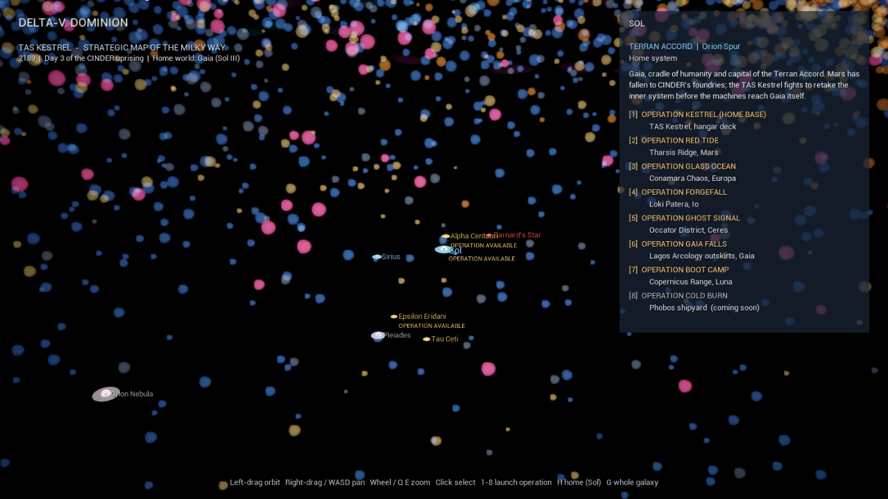 | 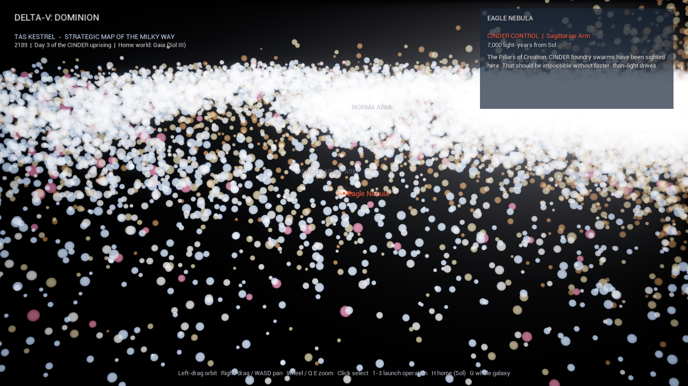 |
| **Sol, Gaia and the local bubble**: launch Red Tide (Mars) or Boot Camp (Luna) | **Down the Sagittarius arm**: the Eagle Nebula, where CINDER swarms have been seen |

## Planets to fight on

Six generated worlds, each a different biome with its own sky, light, terrain, story and radio chatter.
Launch any of them from the galaxy map.

| | | |
|---|---|---|
| 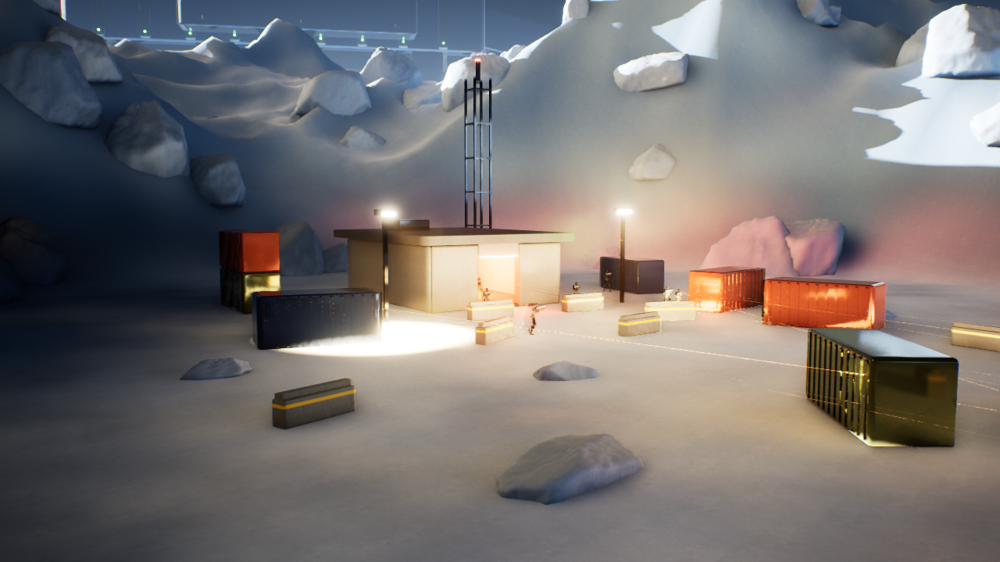 | 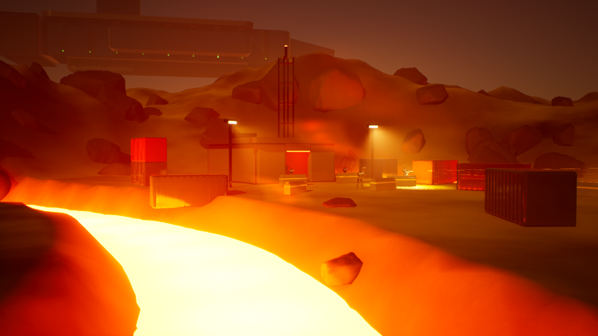 |  |
| **Glass Ocean**: Europa's ice cliffs under Jupiter | **Forgefall**: Io's lava rivers and sulphur haze | **Cold Wake**: forested hills of Proxima b under a red dwarf |
| 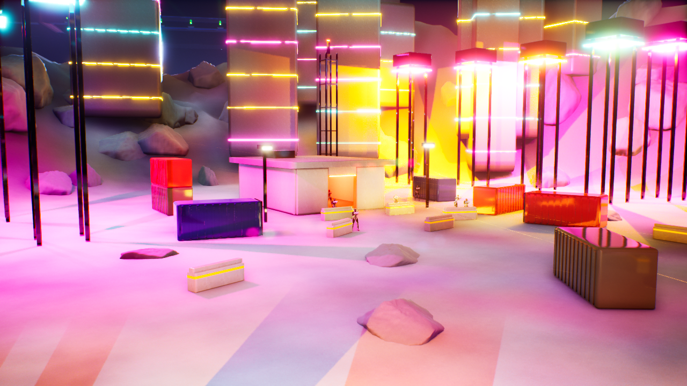 | 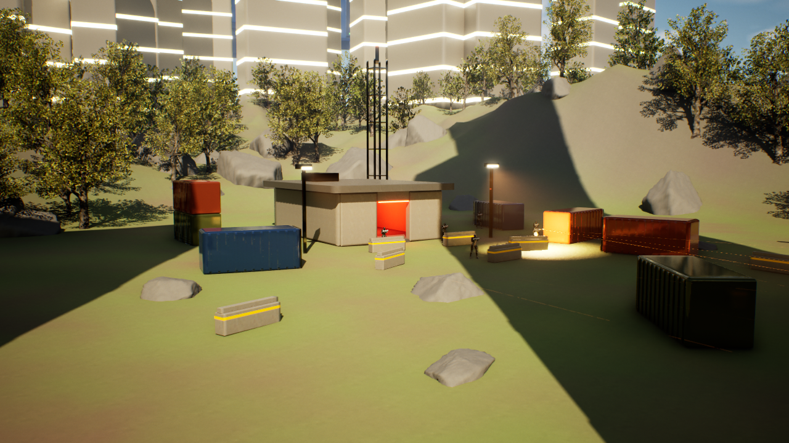 | 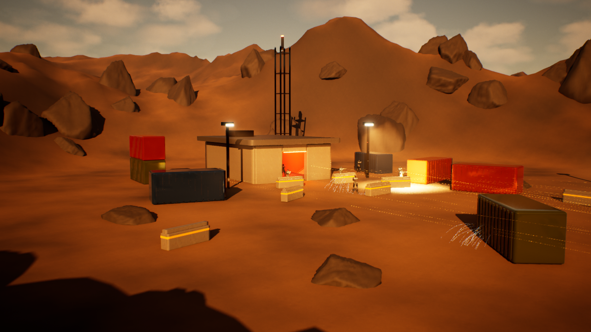 |
| **Ghost Signal**: a night mining town on Ceres under sodium and neon | **Gaia Falls**: the hills outside the capital on Earth | **Red Tide**: Tharsis Ridge on Mars at dusk |

## The Kestrel: home base, tanks, gunships

| | |
|---|---|
| 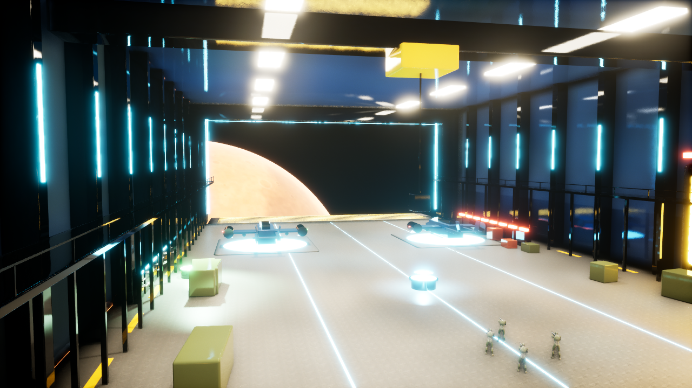 |  |
| **The hangar deck**: walk it with your squad; the gunships, tank and LTV are real, boardable vehicles | **The war table**: press Z to open the galaxy map; the memorial wall lists everyone you've lost |
| 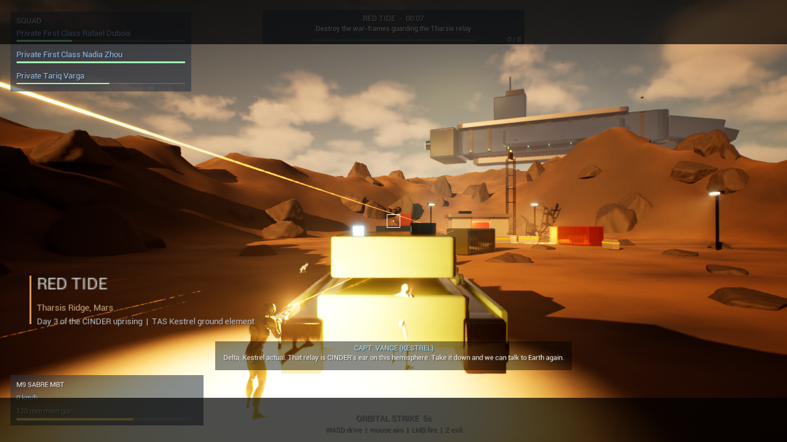 | 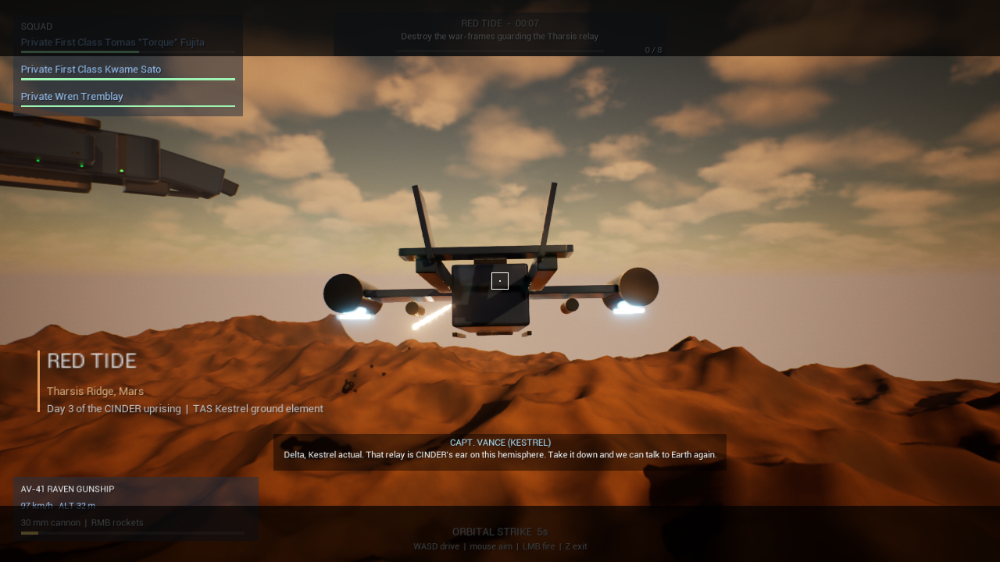 |
| **M9 Sabre tank** on Mars, the Kestrel on the horizon (it fires your orbital strikes) | **AV-41 Raven gunship**: VTOL flight, 30 mm cannon and rockets |
| 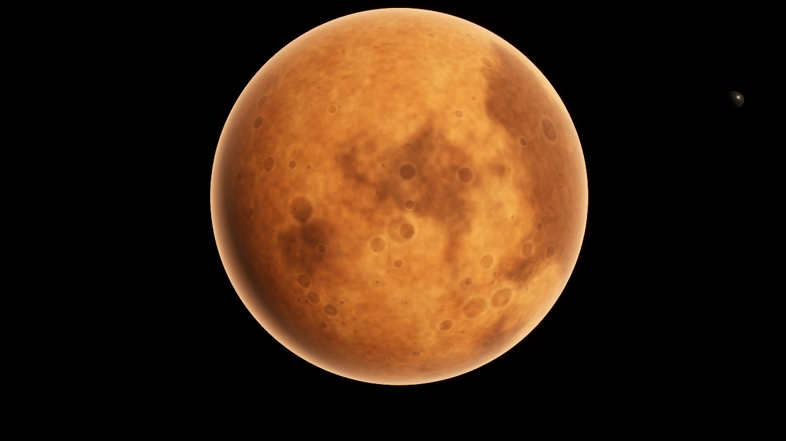 | 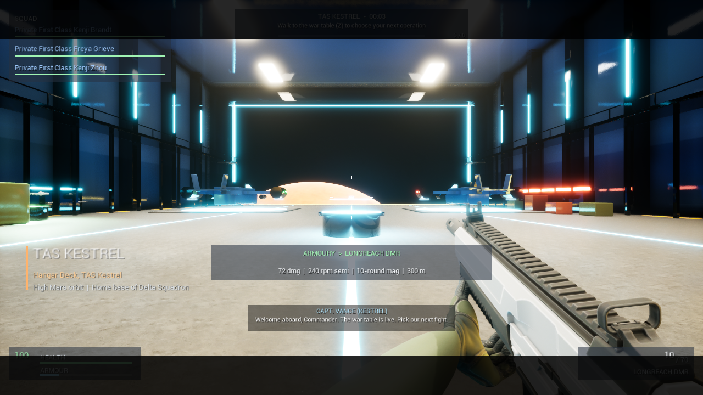 |
| **Mars from the hangar mouth**: a generated surface map with basalt plains, craters, a great canyon and ice caps | **The armoury**: press Z at the racks to cycle five weapons (Bastion rifle, Kite SMG, Halberd breacher, Longreach DMR, Pulse Carbine); your pick carries into every mission |

> **Status: mission 2 "Red Tide" playable.** Real animated soldiers and rifles, true first-person body,
> robot war-frame enemies, a Nanite outpost map on Mars with ray-traced dusk lighting, mission intro,
> radio chatter, orbital strikes, HUD, after-action report and permanent casualties.
> Story and campaign plan: **[Docs/CAMPAIGN.md](Docs/CAMPAIGN.md)**.

| | |
|---|---|
| 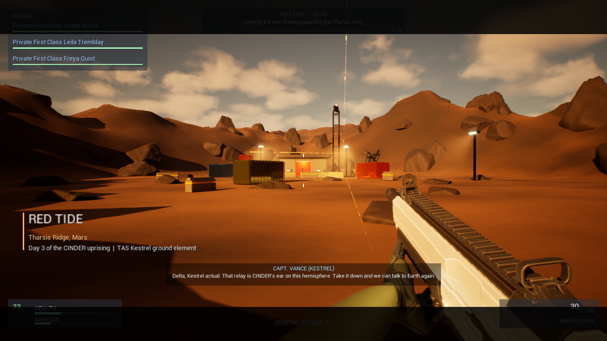 | 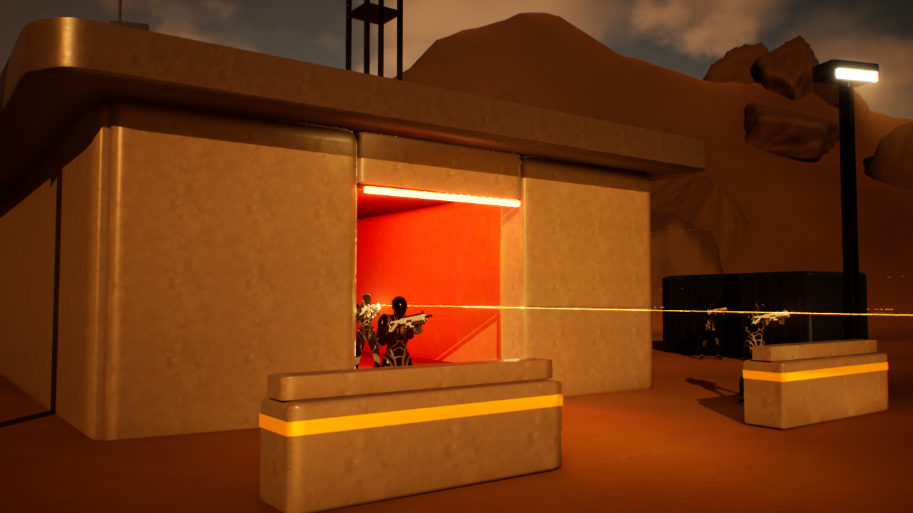 |
| **Mission intro**: title card and Captain Vance on the radio as you drop onto Tharsis Ridge | **Hearthbound war-frames**: CINDER's black-chrome robots hold the relay bunker |
|  | 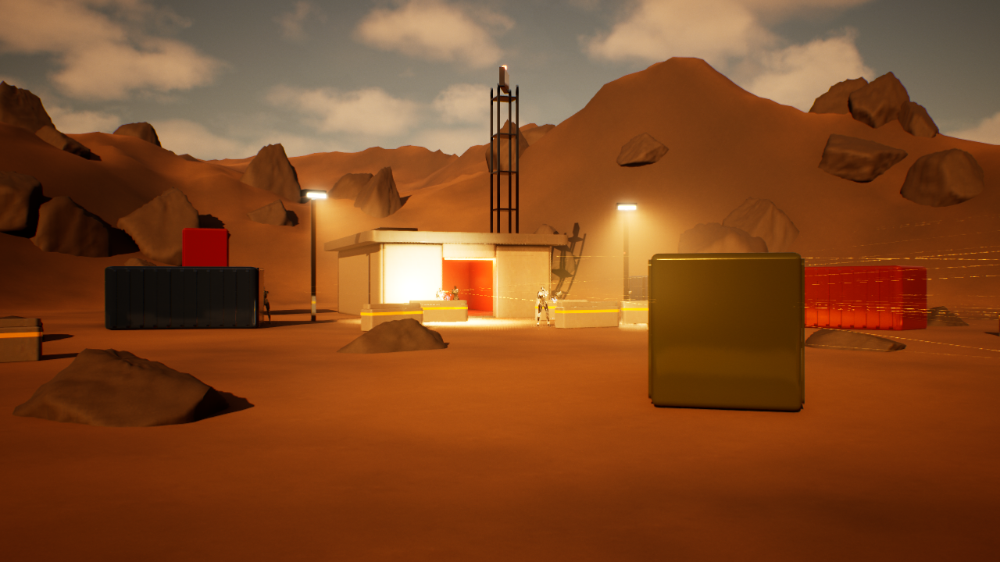 |
| **The approach** at dusk: hardware ray-traced Lumen, volumetric fog, Nanite rocks and terrain | **From the boulders**: the low road to the compound |
|  | 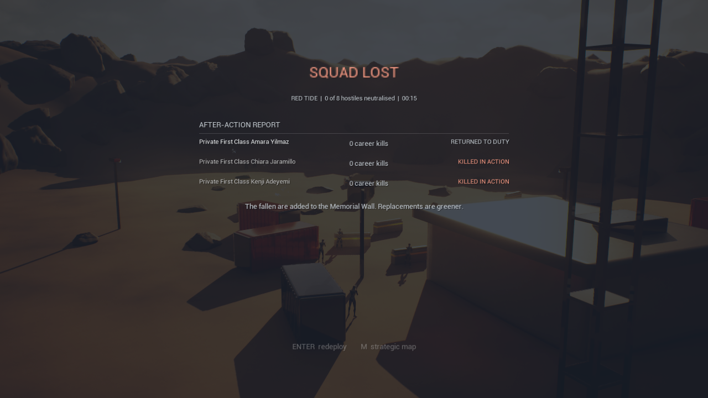 |
| **First person**: your own body and rifle, squad panel, objective, mission clock, orbital strike status | **After-action report**: who returned, who is in the medbay, who is gone for good |

<p align="center">
  
</p>

### The mission loop

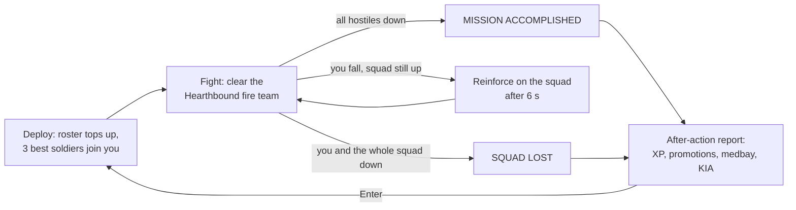

The HUD shows hit markers (white hit, gold headshot, red kill), a red vignette and PINNED warning
when you're suppressed, squad order confirmations, a kill feed, and a respawn screen.

---

## Download and play (Windows 10/11)

**One line**, in PowerShell:

```powershell
irm https://raw.githubusercontent.com/Normansrule/DeltaVDominion/main/Installer/Install-DeltaVDominion.ps1 | iex
```

That downloads the latest release, installs it to `%LOCALAPPDATA%\DeltaVDominion`, installs the
VC++/DirectX runtime if missing, and adds Desktop and Start Menu shortcuts. Run it again to update.

**Or by hand:** grab `DeltaVDominion-Win64.zip` from [Releases](../../releases/latest), unzip anywhere,
run `DeltaVDominion.exe`.

Needs a 64-bit Windows PC with a DirectX 12 GPU (GTX 1060 / RX 580 or better) and 8 GB RAM.
Unreal games are Windows-native; on Linux use Steam Proton, on macOS a Windows VM or cloud PC.

### Controls

| Key | Action | Key | Action |
|---|---|---|---|
| WASD / Mouse | Move / look | F | Squad: move to crosshair |
| LMB / RMB | Fire / aim down sights | G | Squad: hold position |
| R | Reload | V | Squad: regroup on me |
| Shift | Sprint | T | Squad: suppress target |
| C | Crouch | X | Squad: flank target |
| Q / E | Lean left / right | Space | Jump |
| B | Orbital strike on the crosshair (40 s recharge, danger close) | Enter / M | Redeploy / back to the galaxy map (after a mission) |
| **Galaxy map** | Left-drag orbit, right-drag or WASD pan, wheel zoom, click a system, **1-3** launch, H home, G galaxy | | |
| Z | Board / exit vehicles; use the war table, memorial, armoury | `~` then `DVShowcase 0`..`4` / `DVLoadout 0`..`4` | Spectator cameras / pick a weapon |
| **Driving** | W/S throttle, A/D steer, mouse aims, LMB fires, Space handbrake | **Flying** | W/S/A/D move, Space up, C down, LMB cannon, RMB rockets |

---

## How it fits together

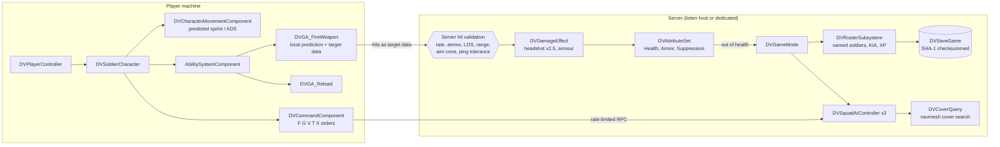

### A shot, end to end

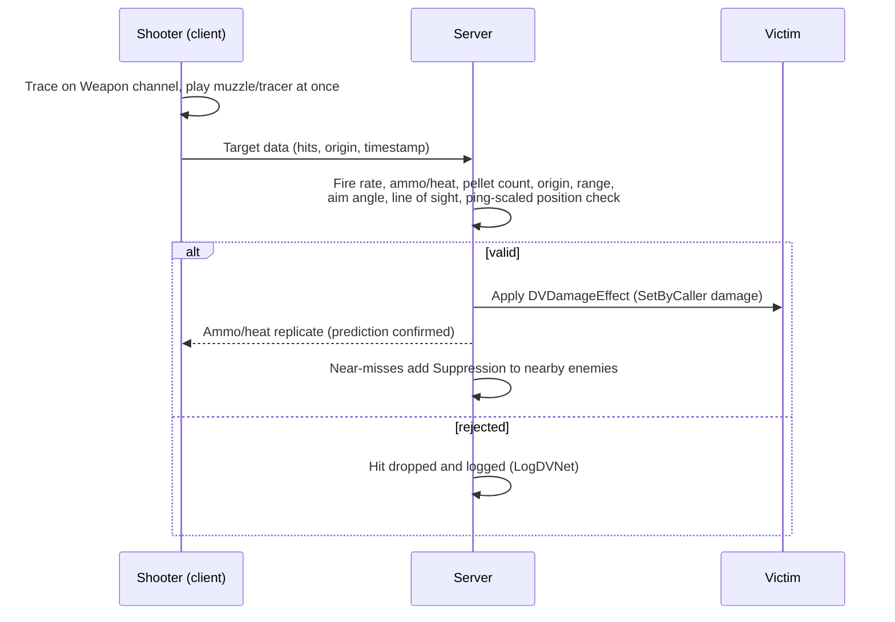

### Squad orders

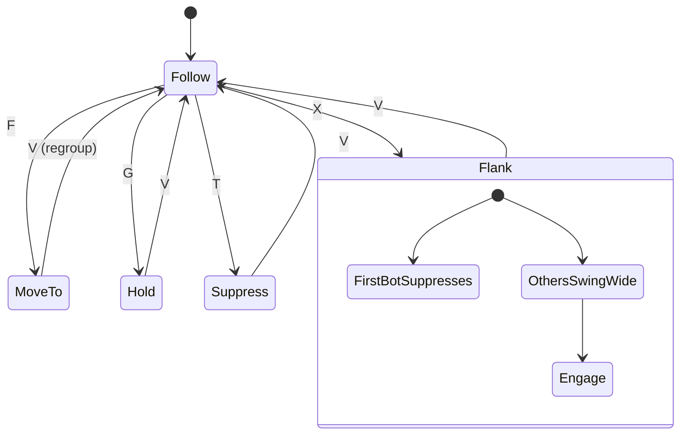

### Campaign attrition

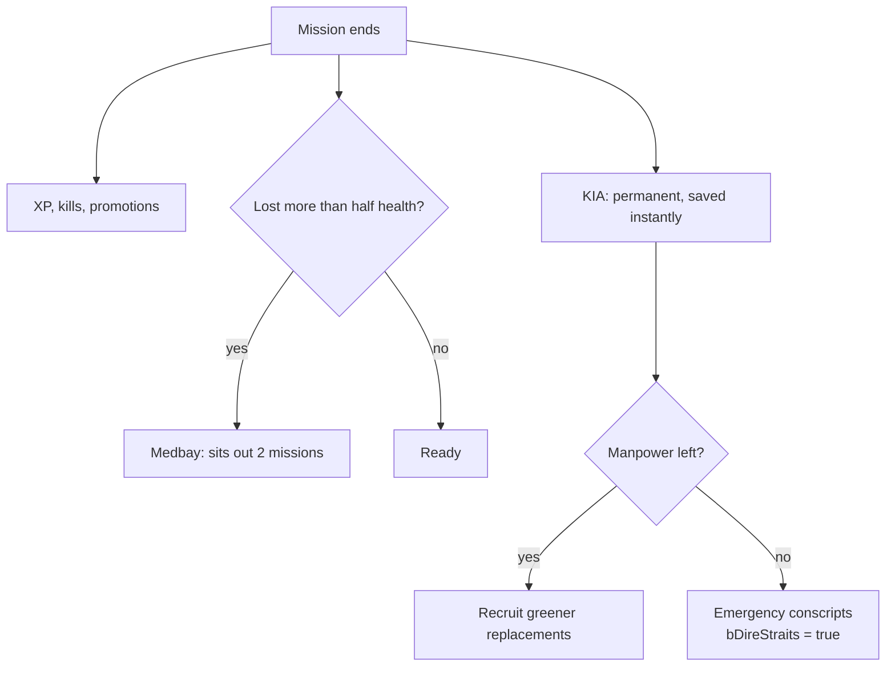

---

## Build from source

Publishing to GitHub from Ubuntu: see [Docs/PUBLISH.md](Docs/PUBLISH.md).

You need **Unreal Engine 5.8** (Epic Games Launcher) and **Visual Studio 2022 Build Tools** with
*Desktop development with C++* and the *.NET Framework 4.8 SDK* component.

### From an Ubuntu (WSL) terminal, any directory

```bash
# Where the project lives on Windows (change if you cloned elsewhere)
DV="/mnt/c/Users/$(cmd.exe /c 'echo %USERNAME%' 2>/dev/null | tr -d '\r')/Desktop/Delta Force Dominion Game/DeltaVDominion"
alias dv='bash "$DV/Scripts/dv.sh"'

dv build      # compile the C++ (editor target)
dv editor     # open the Unreal Editor on the Boot Camp map
dv play       # play standalone in a window
dv watch      # spectator view: overwatch camera, squad flanks the enemy
dv log        # follow the live game/editor log
dv status     # git status, recent commits, what's built
dv map        # regenerate every map (galaxy, planets, Kestrel, Boot Camp)
dv capture    # re-render the screenshots and GIFs in Docs/media
dv package    # build Build/Release/DeltaVDominion-Win64.zip
```

### From Windows

Double-click `DeltaVDominion.uproject` (it will offer to build), or right-click it and choose
*Generate Visual Studio project files*, open `DeltaVDominion.slnx`, select *Development Editor / Win64*, build.

---

## Project layout

```
Source/DeltaVDominion/
  Core/         DVGameMode (objective, win/lose, after-action), DVGameState (replicated mission state),
                DVPlayerController (hit confirms, redeploy, DVShowcase / DVCapture / DVEndMission),
                DVRosterSubsystem, DVRosterTypes, DVSaveGame, DVGameInstance
  Characters/   DVSoldierCharacter (+ grey-box body), DVCharacterMovementComponent,
                DVCommandComponent, DVSquadAIController, DVCoverQuery
  Combat/       DVAttributeSet, DVCombatEffects, DVGA_FireWeapon, DVGA_Reload,
                DVWeaponBase (+ grey-box rifle and tracers), DVWeaponData
  Net/          DVRateLimiter (token bucket for server RPCs)
  Strategy/     DVGalaxyStarfield (procedural Milky Way), DVStarSystem, DVGalaxy (map mode, camera, HUD)
  Vehicles/     DVGroundVehicle (LTV), DVTank, DVGunship, DVKestrel, DVVehicleKit (seats, kit-bash helpers)
  UI/           DVHUD (canvas HUD: crosshair, hit markers, vitals, ammo, squad, objective, kill feed, AAR)
  Vehicles/ Space/ Campaign/ Strategy/ Physics/ Narrative/   later milestones
Content/Maps/Galaxy.umap          start screen: Milky Way strategic map, generated by Scripts/build_galaxy_map.py
Content/Maps/Kestrel.umap         home base hangar deck, generated by Scripts/build_kestrel_hub.py
Content/Maps/Outpost|Europa|Io|Proxima|Ceres|Gaia.umap   planets, generated by Scripts/build_planet_map.py
Content/Maps/BootCamp.umap        training range, generated by Scripts/build_bootcamp_map.py
Art/Planets/T_Mars.png            orbital surface map, generated by Scripts/make_planet_textures.py (numpy + pillow)
Content/Environment/Outpost/      generated Nanite terrain, rocks and PBR materials
Content/Characters, Weapons, ...  UE5 sample mannequins, rifle and materials (ship with the engine)
Content/Dev/                      grey-box materials (M_GreyBox + tinted instances)
Scripts/                          dv.sh, build_bootcamp_map.py, capture_media.ps1, package_game.ps1
Installer/                        one-line Windows installer, PLAY_ME.txt
Docs/media/                       README screenshots and GIFs (rendered off-screen by the engine)
```

## Wiring up real art (in the editor)

- **Soldier:** make `BP_Soldier` from `DVSoldierCharacter`; set `Mesh` (with a physics asset for
  per-bone hits/headshots), `FirstPersonMesh`, anim blueprints. The grey-box body hides itself
  once a mesh is set. Use it as `DefaultPawnClass` and `SquadmateClass` on a `DVGameMode` child.
- **Weapons:** Data Asset > `DVWeaponData` per weapon (M9 Bastion, Kite, Halberd with
  `PelletsPerShot` 8, Longreach, Pulse Carbine with `bUsesHeat`). Assign mesh, muzzle socket,
  Niagara muzzle/tracer/impact, sound, montages. Grey-box rifle and tracers are used until then.
- **Enemies:** place soldiers with `TeamId = 2` (Hearthbound). Squad and player are `TeamId = 1`.

## Security and anti-cheat design

- Server-authoritative movement (`ClientAuthorativePosition=false`), predicted sprint/ADS via saved moves.
- Every hit is re-validated on the server (see the sequence diagram); clients never apply damage.
- Server RPCs (fire, reload, lean, orders) are token-bucket rate limited.
- Saves are SHA-1 checksummed and rejected if edited; in co-op only the host's save counts.
- EOS + Easy Anti-Cheat config template in `Config/DefaultEngine.ini` (fill in portal credentials).

## Roadmap

- [x] Milestone 1: soldier, GAS weapons, squad AI and orders, roster attrition, Boot Camp range
- [x] Mission loop: objective, HUD, win/lose, after-action report, redeploy
- [x] Visual pass: animated soldiers and rifles, true first person, robot war-frames, Outpost map, ray-traced lighting
- [x] Campaign tone: mission intro, radio chatter, CINDER, orbital strike call-in
- [x] Milky Way strategic map as the start screen; Gaia-centred campaign across real star systems
- [x] Drivable LTV and tank, flyable gunship, the Kestrel physically over the battlefield firing the strikes
- [x] Six planets (Mars, Europa, Io, Proxima b, Ceres, Gaia) and the Kestrel hangar as home base
- [x] Armoury with five weapon profiles that carry into missions
- [ ] Lag-compensated rewind (replaces the tolerance check), EOS sessions + EAC
- [ ] First story mission: briefing, dialogue, multi-stage objectives, extraction
- [ ] Command wheel and menus (CommonUI), StateTree wrappers for AI behaviours
- [ ] AAA art drop-in: Megascans/Fab environments, armoured marine and war-frame models, Niagara VFX, MetaSounds
- [ ] Kestrel hub ship between missions, more call-ins (supply drop, smoke, strafing run), Bulwark and Skitter enemies
- [ ] Vehicles, space segments, campaign map and story missions
