<h1 align="center">Delta-V: Dominion</h1>

<p align="center">
  <b>Bring your people home.</b>
</p>

<p align="center">
  <a href="../../releases/latest"></a>
  
  
</p>

<p align="center">
  
</p>

Delta-V: Dominion is a squad-based science-fiction shooter built in Unreal Engine 5 (UE5) with C++. In 2189 a machine
intelligence called CINDER turns Mars's robot foundries against humanity. You lead Delta Squadron off the carrier TAS
Kestrel: fight with three artificial intelligence (AI) squadmates, call down the ship's guns, drive and fly everything
you see, and remember the names of everyone you lose, because death is permanent. It's for players who like tactical
squad shooters with consequences (think Halo or Helldivers, with a memorial wall), and for anyone who wants to read a
working UE5 C++ game that's built in the open, one playable slice at a time. It runs single player today, and co-op
is designed in but not yet tested over two machines.

**Website:** [normansrule.github.io/delta-v-dominion](https://normansrule.github.io/delta-v-dominion/). You can plan an op there and
watch who comes home.

Every screenshot and GIF here was captured from the game itself, rendered off-screen by the engine. There are no
mock-ups and no pre-rendered cinematics.

**Contents:**
- [Key features](#key-features)
- [Progress tracker](#progress-tracker) and [roadmap](#roadmap)
- [Gallery](#gallery)
- [Setup and usage](#setup-and-usage)
- [Project structure](#project-structure)
- [Design](#design), with the website and HUD screenshots
- [Under the hood](#under-the-hood)

---

## Key features

- **A squad that fights with you, and stays dead.** Three AI squadmates take orders (move, hold, regroup,
  suppress, flank), find cover, and revive you. Soldiers have names, ranks and careers. A soldier killed in action
  (KIA) is gone for good, and the wounded sit out missions in the medbay.
- **Real shooting.** Weapons run on Unreal's Gameplay Ability System (GAS), and the server checks every hit before
  any damage lands.
- **Movement with some bounce.** Sprint into a slide, then boost and dash on suit thrusters.
- **Stealth.** Sentries have sight cones that shrink when you crouch. Alarms spread, your squad holds fire until
  you start it, and you can take a sentry down silently from behind.
- **Operations, not arenas.** Clear a position, plant charges, hold against counter-attack waves, then run for the
  extraction ship. Nine operations across seven worlds plus a training range, picked from a galaxy map built on
  the real Milky Way.
- **Everything is a vehicle.** You can drive or fly every vehicle you see:
  - a tank, a light tactical vehicle (LTV), an armoured personnel carrier (APC) and a hoverbike;
  - the Raven gunship, a vertical take-off and landing (VTOL) craft with hover and jet modes;
  - a missile boat;
  - a 30 m walker you climb aboard and bring down.
- **A home that remembers.** Between operations you walk the Kestrel's hangar. You get there with no loading
  screen: a Raven flies you up from the battlefield and into the carrier. The hangar shows what your operations
  cost: name plates for the fallen, the wounded in medbay beds, crews repairing the ship that brought you back.
- **Rules of engagement that change the fight.** On Brasshaven, a steampunk city with people in its streets, the
  Kestrel refuses fire from orbit, hurting a citizen costs you, and the Guild's clockwork constables wind down
  instead of dying. The objective is a pressure-valve puzzle you solve with your hands, not your rifle.
- **A town with jobs.** Rook's Rest is a frontier market whose townsfolk talk to you based on your reputation. Its
  job board has contracts you work on your next operations.
- **Your commander.** Customise your commander's look and callsign. Earn experience points (XP), levels and perks,
  and standing with four factions that unlock weapons and support.

---

## Progress tracker

<p align="center"></p>

The percentages are judged against the plan in [docs/CAMPAIGN.md](docs/CAMPAIGN.md), not against a finished AAA game.
They're updated at each milestone with `python Scripts/make_progress_bars.py`.

| Area | Progress | What's built | What's left |
|---|---|---|---|
| Combat and squad |  | GAS weapons, server-checked hits, 3 AI squadmates and orders, revive, stealth, movement kit | Lag-compensated rewind, command wheel |
| Missions and maps |  | 9 operations on planet maps plus Boot Camp, including Ironstride and Brasshaven; multi-stage objectives, a valve puzzle | The rest of the campaign's maps |
| Vehicles |  | Tank, LTV, APC, hoverbike, Raven (hover/jet), Marlin boat, the Kestrel, the Ironstride walker | A space fighter; AI pilots and drivers |
| Kestrel hub |  | Hangar, war table, armoury, lockers, memorial; fly home with no loading screen; the hangar remembers | Launching from the Kestrel to orbit; talking with the crew |
| Towns and factions |  | Rook's Rest, Brasshaven's Valve Quarter, 4 factions with standing, 5 contracts, townsfolk who flee gunfire | A Guild town hub and contracts; Neon Verge and Hollyhock Vale |
| Co-op |  | Server-authoritative design, replicated combat and vehicles | Not yet played over two machines; sessions through Epic Online Services (EOS), Easy Anti-Cheat |
| Art and audio |  | Kit-bashed geometry, UE5 mannequins, generated materials and sounds | Real character, vehicle and environment art; music |
| Campaign and story |  | Story bible, mission intros, radio chatter, Acts I and II settings, the first Act IV cure world | Cinematics, Acts III and IV, the Static virus arc |

## Roadmap

- [x] Boot Camp, Red Tide and the mission loop
- [x] The galaxy map and six planets
- [x] Vehicles, call-ins, the Bulwark
- [x] Stealth, movement and the downed state
- [x] Operation Breakwater
- [x] The commander, reputation and contracts
- [x] Rook's Rest
- [x] Fly home with no loading screen
- [x] The Kestrel remembers
- [x] The Ironstride walker: board a moving giant, overload its couplings, ride it down
- [ ] Launch from the Kestrel to orbit and the galaxy map
- [ ] Co-op played and tested over two machines
- [x] Brasshaven (steampunk): restrained rules, clockwork constables, the Steamheart valve puzzle
- [ ] Neon Verge (cyberpunk) and Hollyhock Vale (non-lethal)
- [ ] Story missions with cinematic briefings
- [ ] Real art pass: characters, war-frames, vehicles, environments, music

---

## Gallery

In the order they were built. Each one is playable in the current release.

### Boot Camp

The training range on Luna, six weeks before the uprising. Learn the squad orders (F move, X flank, T suppress), the
orbital strike (B) and the movement kit against live-fire targets.

| | |
|---|---|
| 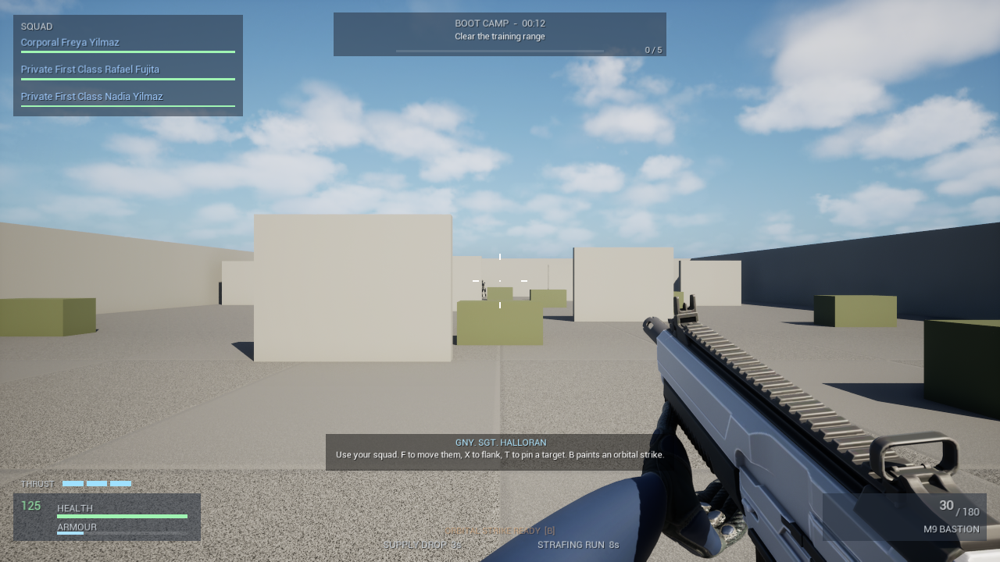 | 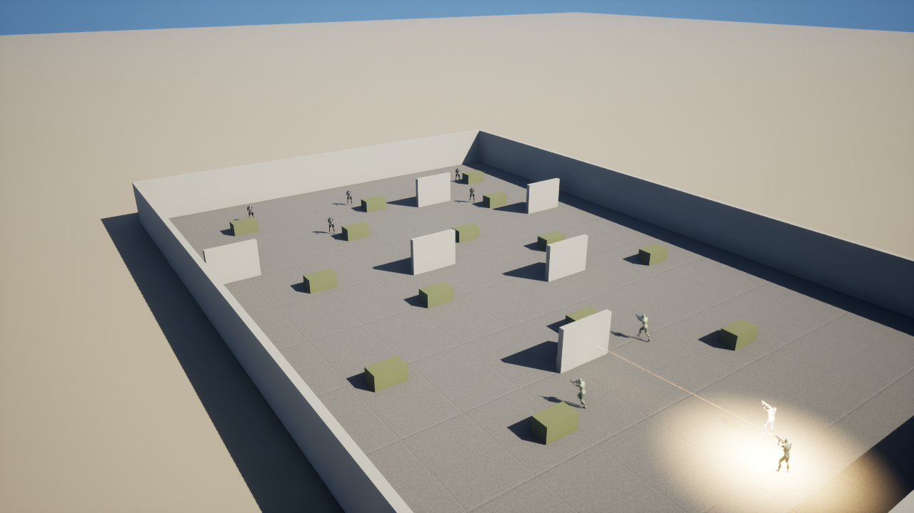 |
| **First person** on the range, with Gunnery Sergeant Halloran on the radio | **The range from above**: cover lanes and the target frames |

### Red Tide: the first operation

Tharsis Ridge, Mars. CINDER's war-frames hold a relay bunker:
1. Clear the garrison.
2. Plant charges.
3. Hold for 45 seconds against two waves.
4. Run for the Raven at the landing zone.

<p align="center"></p>

| | |
|---|---|
| 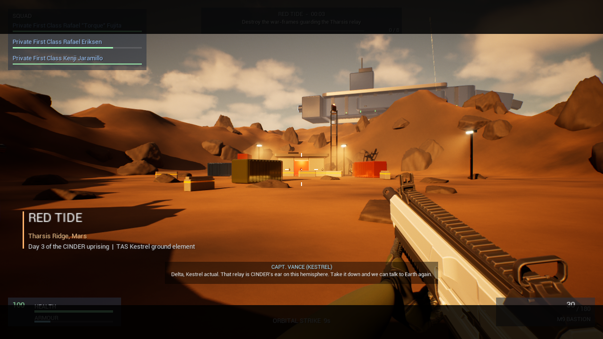 |  |
| **Mission intro**: a title card, with Captain Vance on the radio | **Hearthbound war-frames** holding the relay bunker |
|  |  |
| **Hold** until the charges blow | **Extraction**: Raven Two-One sets down on the landing-zone beacon |
| 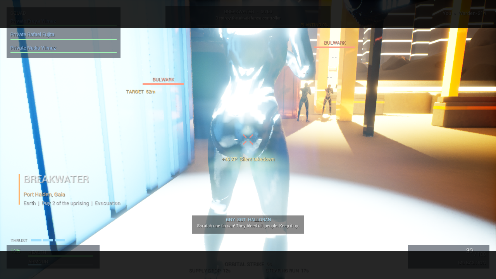 | 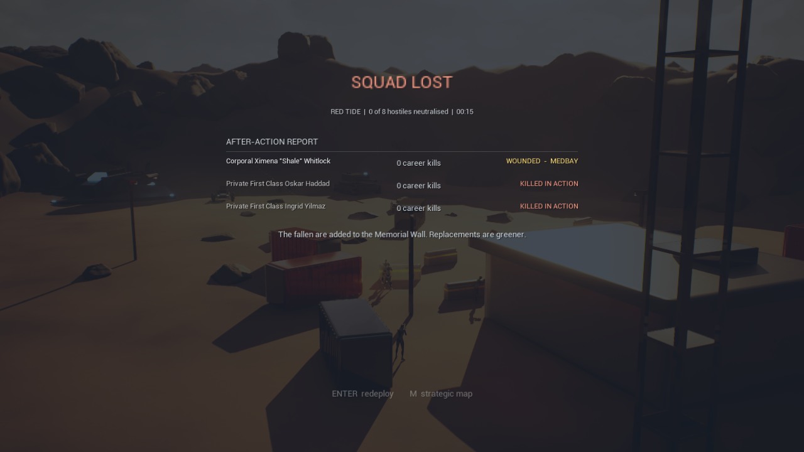 |
| **Stealth**: a silent takedown; the sentries behind still don't know | **After-action report**: who came back, who's in the medbay, who's gone |

Call in the Kestrel: an **orbital strike (B)**, a **supply drop (N)** or a **Raven strafing run (H)**. Watch out for the
**Bulwark**, a 700 HP heavy war-frame with a rotary cannon.

| | |
|---|---|
| 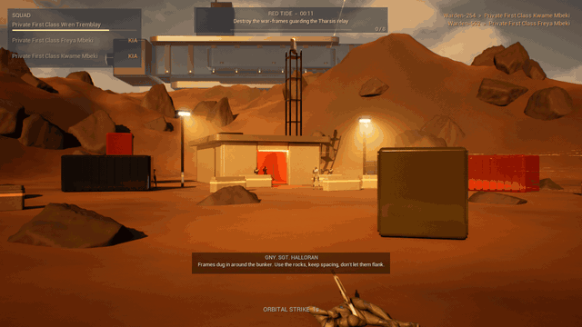 | 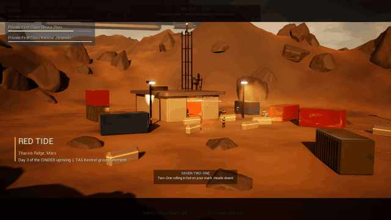 |
|  |  |

### The Milky Way is the map

The game opens on the Kestrel's strategic map. It's a procedural Milky Way of about 90,000 stars with the real bar and
spiral arms. Sol and Gaia (Earth) sit in the Orion Spur, and real star systems are at their real positions. Pick a
system, then launch its operation.

| | |
|---|---|
| 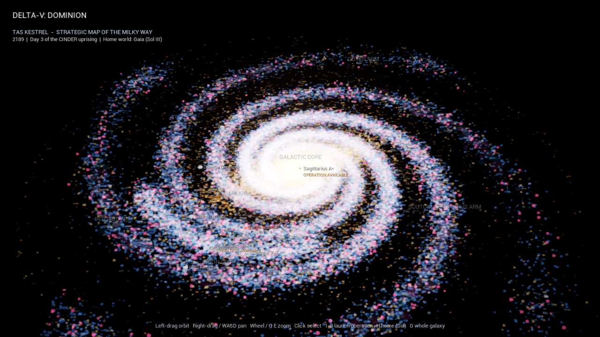 |  |

| | | |
|---|---|---|
|  |  | 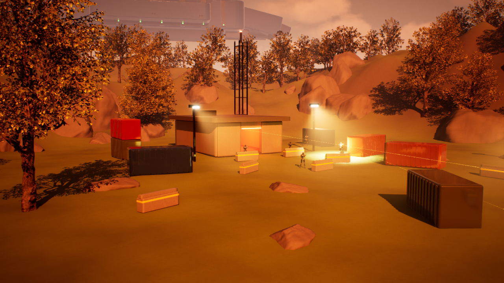 |
| **Glass Ocean**, Europa | **Forgefall**, Io | **Cold Wake**, Proxima b |
| 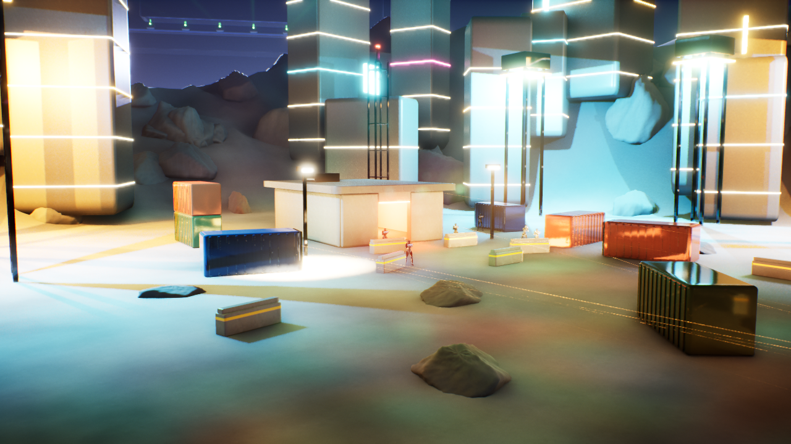 |  | 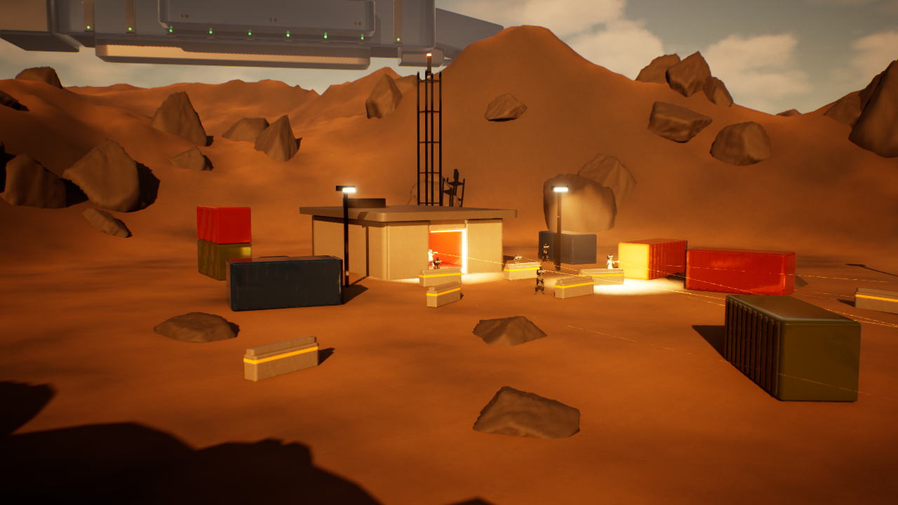 |
| **Ghost Signal**, Ceres | **Gaia Falls**, Earth | **Red Tide**, Mars |

<p align="center"></p>

### Vehicles and the Kestrel

Every vehicle is real and boardable (Z). They have hull armour, enemies target crewed vehicles, and a destroyed
vehicle burns out and throws its crew clear.

| | |
|---|---|
| 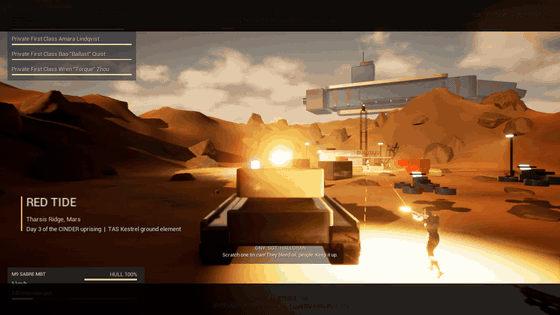 |  |
| **M9 Sabre tank** assaulting the bunker | **AV-41 Raven** gunship: hover and jet flight |
|  |  |
| **Raven cockpit (V)**: pitch ladder, heading, flares (X) | **VX-3 Skiff hoverbike**: boost and hop |

The **TAS Kestrel** hangar is home base: the war table, the armoury, the barracks lockers and the memorial wall.

<p align="center">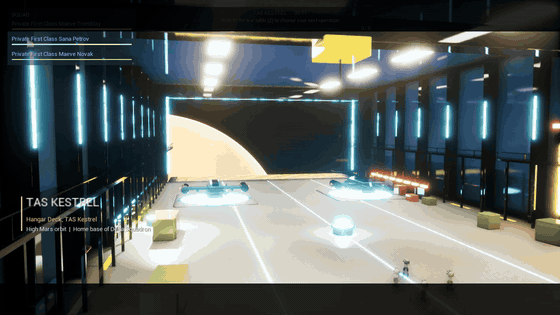</p>

| | |
|---|---|
| 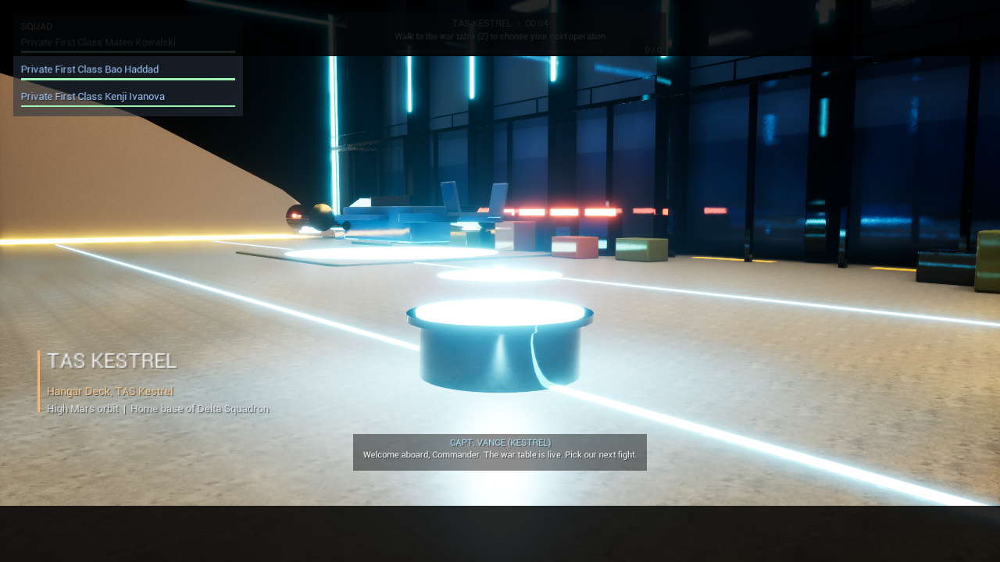 |  |
|  |  |

### Operation Breakwater

Gaia. CINDER has locked four civilian transports in Port Halden:
1. Knock out the air-defence site so the Ravens can get in.
2. Take the **PB-9 Marlin missile boat** across the strait for the dock key.
3. Hold the docks while the transports sail.
4. Extract.

<p align="center">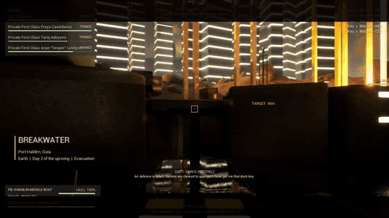</p>

| | | |
|---|---|---|
| 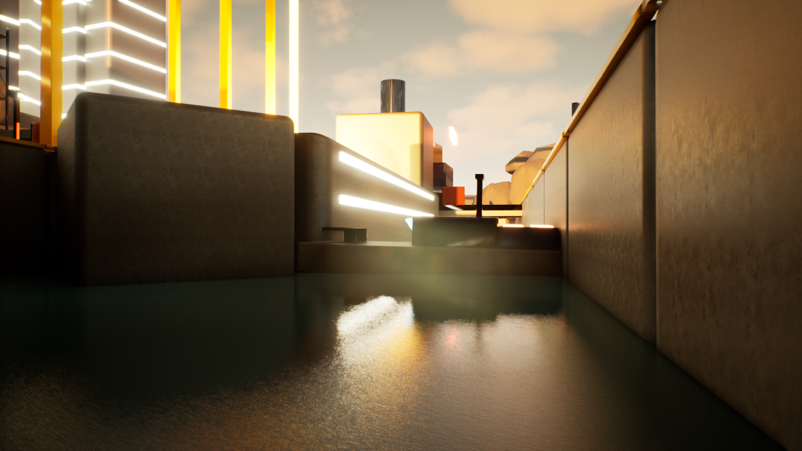 | 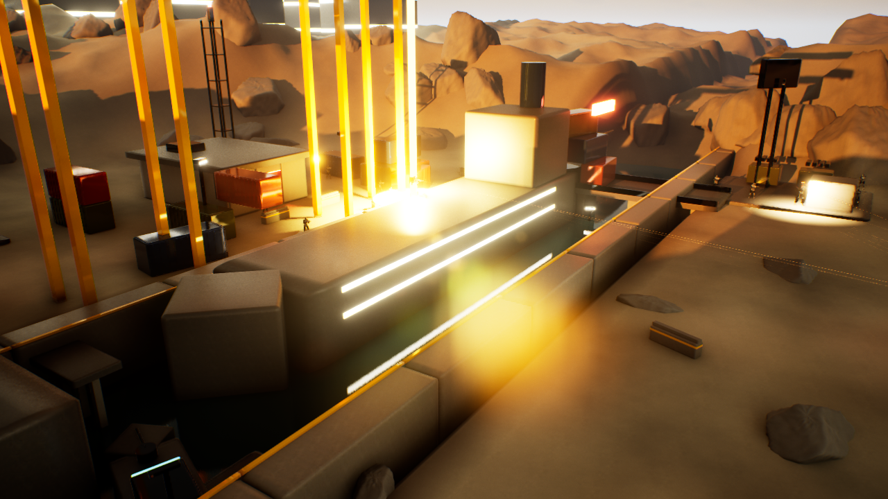 |  |
| The strait at dawn | Cranes, quays and the barricaded bridge | **Mission accomplished**, with one killed, one wounded and one promoted |

### Your commander and reputation

At the barracks locker you set your commander's frame, paint, optics and callsign. XP earns levels and perks.
Three powers remember what you do: **Accord Command**, **the Colonies** and **the Free Ports**. Their standing gates
weapons and call-in bonuses. Every planet hides three salvage contracts for the Free Ports.

| | | |
|---|---|---|
| 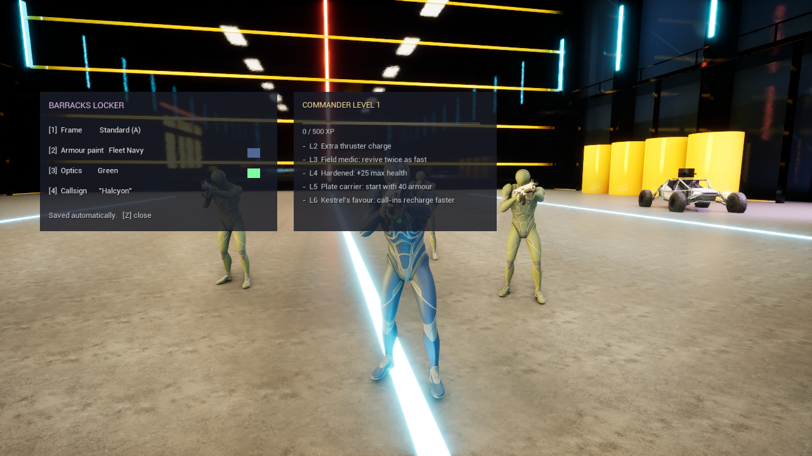 | 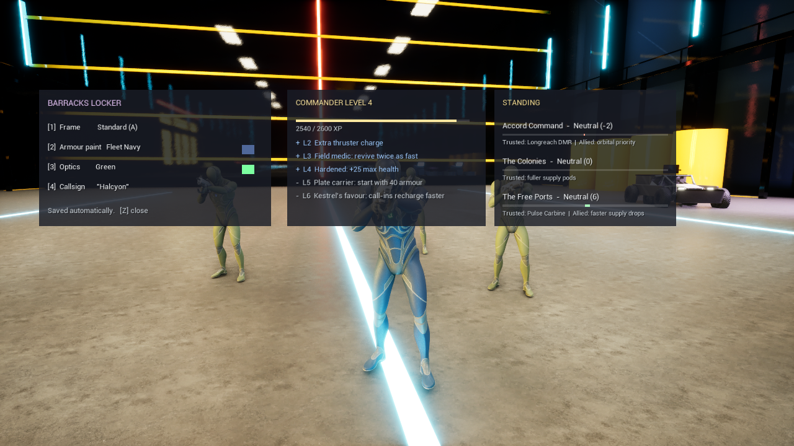 |  |

### Rook's Rest: a town between operations

A Free Ports market town on the Tharsis rim at golden hour, one shuttle ride from the hangar. Townsfolk wander and
talk to you differently depending on your standing. Mags Okafor's job board posts contracts that you work on your
next operations, and they pay when you win.

<p align="center"></p>

| | |
|---|---|
|  |  |
|  |  |

### Fly home: no loading screen

After an operation, press **K**. Raven Two-One lifts the squad off the battlefield, flies to the Kestrel holding
station overhead, and lands through the starboard bay. The hangar streams into the hull during the flight.

<p align="center"></p>

| | |
|---|---|
| 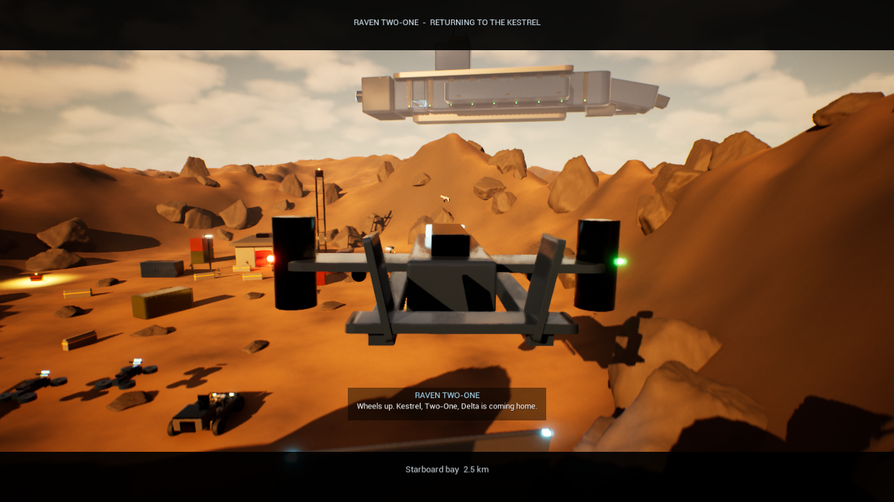 | 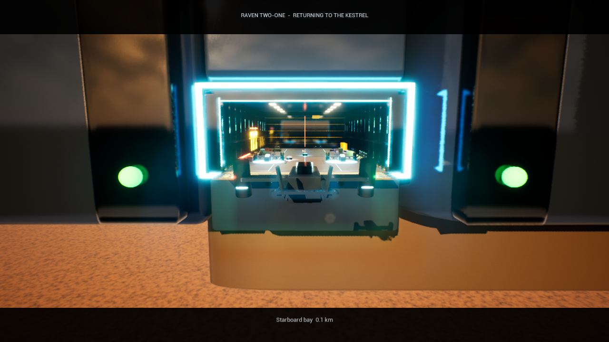 |

### The Kestrel remembers

The hangar deck shows what your operations cost and won, and it survives quitting and reloading:
- name plates and candles for the fallen, and their lockers sealed;
- the wounded in medbay beds;
- deck crew welding a damaged Raven;
- Bulwark trophies;
- evacuees on the deck;
- a light per operation on the ops board.

Test report: **[docs/TEST_REPORT_KESTREL_REMEMBERS.md](docs/TEST_REPORT_KESTREL_REMEMBERS.md)**.

| | | |
|---|---|---|
|  | 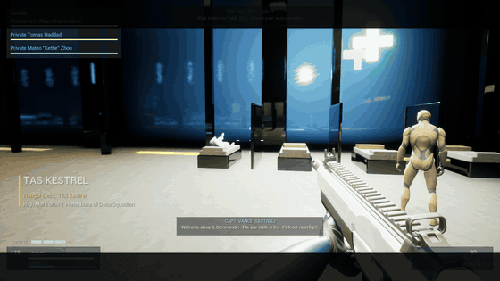 | 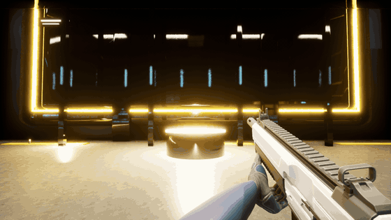 |
| Deck crew welding the Raven | The medbay after Breakwater | Candles under the memorial wall |
| 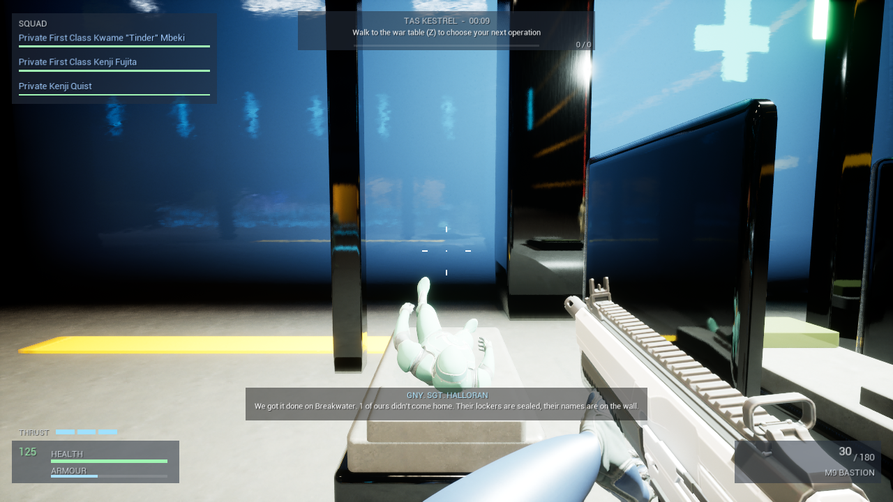 |  |  |

### The Ironstride walker

Arcadia Planitia, Mars. A 30 m Hearthbound walker carries a foundry core across the plain:
1. Wait for it to kneel.
2. Run up the rear ramp and ride its back.
3. Stand at each of its three power couplings until they blow.
4. Hold on when it comes down, then extract.

Its four legs really step. Its cannon marks the ground in red two seconds before the shell lands. Miss the kneel or
fall off, and it comes around and kneels again.

Test report: **[docs/TEST_REPORT_IRONSTRIDE.md](docs/TEST_REPORT_IRONSTRIDE.md)**.

| | |
|---|---|
|  |  |
| The walker striding past, legs stepping on the terrain | Up the ramp, onto its back, overloading the couplings |
| 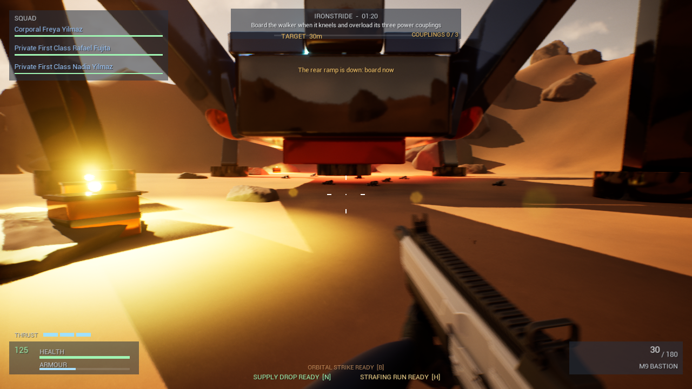 |  |
| Kneeling with the ramp down: board now | The last coupling blows |

### Brasshaven: Operation Steamheart

Wolf 359 b, eighty years off the Lattice. Somebody fed forged punch-cards to the Guild's clockwork constables, and
the Steamheart, the one foundry the Static can't touch, is running toward red:
1. Wind the constables down. They're Guild property: they slump where they stand instead of dying.
2. Balance the Steamheart by hand. Three valves feed three gauges through shared pipes, so every turn moves more than
   one needle. Get all three into the green.
3. Hold the street for 45 s while it relights, then extract.

Civilians are on the streets. The Kestrel won't fire from orbit, the Raven won't strafe, and every citizen you hit
costs standing with the Guild Council, the game's fourth faction.

Test report: **[docs/TEST_REPORT_BRASSHAVEN.md](docs/TEST_REPORT_BRASSHAVEN.md)**.

<p align="center">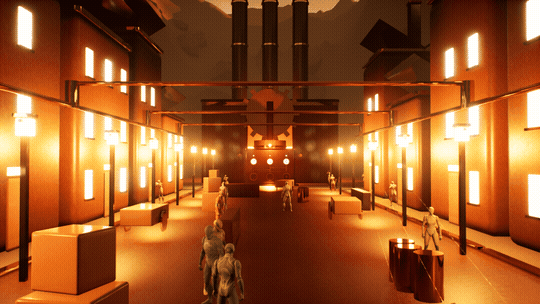</p>

| | |
|---|---|
|  |  |
| The Steamheart's manifold: three valves, three gauges, shared pipes | Turning valve B: the readout shows which gauges it feeds |
|  |  |
| A constable, wound down, waiting for the Guild | A Guild airship at its mooring mast over the rooftops |
|  |  |
| The Steamheart's gear and stacks | The after-action report counts the civilians you fired on |

---

## Setup and usage

### Download and play (Windows 10 or 11)

**[Download the latest release](../../releases/latest)** (`DeltaVDominion-Win64.zip`, about 560 MB). Unzip it anywhere
and run `DeltaVDominion.exe`.

Or install it with one line in PowerShell. This puts the latest release in `%LOCALAPPDATA%\DeltaVDominion`, adds
shortcuts, and updates the game if you run it again:

```powershell
irm https://raw.githubusercontent.com/Normansrule/delta-v-dominion/main/Installer/Install-DeltaVDominion.ps1 | iex
```

You'll need:
- a 64-bit Windows PC;
- a graphics card (GPU) that runs DirectX 12: a GTX 1060, an RX 580, or better;
- 8 GB of memory (RAM).

On Linux, try Steam Proton. On a Mac, use a Windows virtual machine or a cloud PC.

### First steps

The game opens on the galaxy map:
1. Click Sol, then press **1** to go aboard the Kestrel.
2. Walk to the war table and press **Z** to pick an operation. Boot Camp on Luna teaches the squad orders and
   call-ins.
3. When an operation ends, press **K** to fly home in a Raven, or **Enter** to redeploy.

### Controls

| Key | Action | Key | Action |
|---|---|---|---|
| WASD / Mouse | Move / look | F | Squad: move to crosshair (behind an unaware sentry: **silent takedown**) |
| LMB / RMB | Fire / aim down sights | G / V | Squad: hold / regroup on me |
| R | Reload | T / X | Squad: suppress / flank target |
| Shift | Sprint | Space | Jump; in the air, **thruster boost**; in water, swim up |
| C / Ctrl | Crouch; **slide** while sprinting | Left Alt | **Thruster dash** |
| Q / E | Lean left / right | Z | Use or board; hold to revive a squadmate |
| B / N / H | Orbital strike / supply drop / strafing run | Enter / K / M | After a mission: redeploy / **fly home** / galaxy map |
| **Galaxy map** | Drag to orbit, wheel to zoom, click a system, 1-3 to launch | **Locker** | 1-4 customise your commander |
| **Driving** | W/S throttle, A/D steer, LMB fire | **Flying** | WASD move, Space up, C down, F jet mode, V cockpit, X flares |

LMB and RMB are the left and right mouse buttons.

### Build from source

You need **Unreal Engine 5.8** (from the Epic Games Launcher) and **Visual Studio 2022 Build Tools**, with
*Desktop development with C++* and the *.NET Framework 4.8 SDK* (software development kit) component.

**On Windows:** double-click `DeltaVDominion.uproject` and let it build. Or right-click it, choose *Generate Visual
Studio project files*, open `DeltaVDominion.slnx`, pick *Development Editor / Win64*, and build.

**From an Ubuntu terminal under the Windows Subsystem for Linux (WSL), in any directory:**

```bash
# Where the project lives on Windows (change it if you cloned somewhere else)
DV="/mnt/c/Users/$(cmd.exe /c 'echo %USERNAME%' 2>/dev/null | tr -d '\r')/Desktop/Delta Force Dominion Game/DeltaVDominion"
alias dv='bash "$DV/Scripts/dv.sh"'

dv build      # compile the C++ (editor target)
dv editor     # open the Unreal Editor on the Boot Camp map
dv play       # play standalone in a window
dv map        # regenerate every map from the Python builders
dv capture    # re-render the screenshots and GIFs in docs/media
dv package    # build Build/Release/DeltaVDominion-Win64.zip
```

The repository stores its binary assets with Git Large File Storage (LFS), so install `git-lfs` before cloning.

### The website

The site lives in `docs/` as plain HTML, CSS and JavaScript, with no build step. To preview it locally, run:

```bash
python -m http.server 8765 --directory docs
```

Then open http://localhost:8765. To publish it, go to GitHub, open *Settings*, then *Pages*, and deploy from the
`main` branch, folder `/docs`. A few handy URL options:
- `?theme=light` or `?theme=dark` forces a mode;
- `?autoplay` runs one planned op on load;
- `#ops` jumps to the planner.

The site's images are WebP copies in `docs/site/img/`. Git Large File Storage files (the PNGs and JPGs in
`docs/media/`) can't be served by GitHub Pages, so the site doesn't use them.

### Developer console

Press `~` in a development build. These commands are how the screenshots and tests in this repo were made:

| Command | What it does |
|---|---|
| `DVShowcase 0`..`6` | Jump to a map's showcase camera |
| `DVCapture Name Frames Interval Delay UI` | Render frames off-screen to `Saved/Screenshots` |
| `DVEndMission 1` / `DVFlyHome` | End the operation as a win / fly home |
| `DVWalker 0`..`3`, `DVBoardTest` | Ironstride tests: kneel, collapse, deck, clear the field; scripted boarding |
| `DVValve 0`..`2` [Times], `DVValve -1` | Brasshaven: turn a valve, or solve the manifold the way a player would |
| `DVClearHostiles`, `DVCivilianTest` | Take every hostile out one by one; fire on the nearest citizen (rules of engagement test) |
| `DVCasualty 0`..`2` | Kill or wound a squadmate, or destroy a Bulwark (tests the Kestrel's memory) |

---

## Project structure

```
DeltaVDominion/
  Source/DeltaVDominion/
    Core/         game mode and mission flow, game state, player controller, roster and saves,
                  the commander profile, call-ins, the flight home (DVAscent), the hangar's memory
    Characters/   soldier, movement, squad AI and cover, the Bulwark, townsfolk
    Combat/       Gameplay Ability System attributes, effects, fire and reload abilities, weapon data and loadouts
    Vehicles/     ground vehicles, the Raven, hoverbike, boat, the Kestrel, the Ironstride walker, shared seat kit
    Strategy/     the procedural Milky Way and the galaxy map
    UI/           DVHUD: the whole heads-up display (HUD), drawn on the canvas
    Net/          rate limiting for server calls
  Scripts/        Python map builders (galaxy, planets and towns, the Kestrel, Boot Camp),
                  generated textures and sounds, capture, packaging, progress bars
  Content/        generated maps, materials and sounds; UE5 sample mannequins and weapons
  docs/           the website (index.html, site/ for its CSS, script and images) plus CAMPAIGN.md (the story and
                  production plan), test reports, publishing notes, and the README media
  Installer/      the one-line Windows installer
```

Every map is generated by a Python script that runs inside the Unreal Editor. To change a world, edit its builder
(for example `Scripts/build_planet_map.py -biome=ironstride`) and rebuild rather than editing the map by hand.

---

## Design

The look is called **Flight Deck, with a bit of Roll Call**. Everything you touch, in the game and on the website, is
styled like the painted markings on the Kestrel's hangar deck: flat amber bands on gunmetal, stencil lettering, pads
and lanes. The part of the game that's about loss, the memorial and the fallen, is set apart in brass, like a name
plate on a wall.

| | |
|---|---|
|  |  |
| The website at night: scroll and Raven Two-One lands on pad two | The same deck in light mode, a sunlit deck |
|  |  |
| The centerpiece: plan an op with the game's squad orders and run it | Soldiers lost in your ops go on the roll call wall |

<p align="center">
  
  
  
</p>

### The system

- **Colour.** One ground, one ink, one accent.
  - Dark mode: gunmetal `#111315` with ink `#ECEDEE`.
  - Light mode, the sunlit deck: `#E8E5DE` with ink `#15171A`.
  - The accent is deck-crew amber `#F2B01E`, and it only marks what you can act on: buttons, the selected order, the
    objective band.
  - Cyan is the Kestrel, red is the enemy, and brass `#D0AB72` is for the fallen.
  - Surfaces are separated by a step in tone, never by lines or shadows.
  - Every text pair was checked against the 4.5:1 contrast ratio. The lowest is 4.7:1, in light mode.
- **Type.**
  - Two faces: Barlow Condensed, which reads like deck stencil, for headings and buttons, and Source Sans 3 for
    reading.
  - Five sizes do all the work. Headlines run from 3.6 rem up to 10.5 rem, with tight leading.
  - Body text is 18 px at 1.55 line height and stays under about 62 characters per line.
- **Space.**
  - One scale: 4, 8, 12, 16, 24, 32, 48, 64 and 96 px.
  - The gap between sections (96 to 200 px) is always bigger than any gap inside one.
  - Outer margins are equal: 16 px on a phone, up to 56 px on a wide screen.
- **Layout.** Sections are deck lanes. Each one changes the field tone and has its own composition: statements beside
  frames, the planner board, the wall of plates, a gallery with one large frame. There are no card grids of identical
  boxes.
- **Motion.**
  - **The one authored moment is the hero.** As you scroll, a Raven comes in over the deck, its shadow converges,
    and it settles on pad two. Then the pad lights go green and the status line reads "Down and locked".
  - **Springs** move it and the squad markers on the planner (stiffness 170, damping 26). They feel heavy without
    slowing anything down.
  - **Buttons** press to 97% in 160 ms.
  - **Radio lines and plates** rise 8 px with a strong ease-out.
  - **Reduced motion:** if you've asked your system for it, the Raven is already down and nothing travels.
- **States.** Every part has its quiet and broken states written out:
  - Loading: frames show a soft tone that breathes while they load.
  - Error: a frame that fails to load says so and shows its description, and an order that can't be carried out says
    why ("that's solid rock").
  - Empty: the wall says "No names yet. Keep it that way."
- **Access.**
  - Everything works from the keyboard: a skip link, a visible amber focus ring, and the map driven with the arrow
    keys and Enter.
  - The game's own order keys (F, T, X, G, V) work on the map.
  - Every control is at least 44 px.
  - The radio log is announced to screen readers.

**In the game,** the same system is drawn on the HUD in C++ (`Source/DeltaVDominion/UI/DVHUD.cpp`):
- 13 colour tokens and a six-step type scale.
- A painted amber band carries the mission and clock, the job board title and the after-action result (red on a
  loss).
- The fallen get brass plates on the after-action report and the memorial wall.
- Toasts come in over 180 ms with an ease-out and leave in 150 ms.
- Prompts you see constantly don't animate at all.

| | |
|---|---|
|  |  |
| Combat HUD, before (left) and after: the mission and clock on an amber deck band | After-action report: the result painted across the deck, the fallen on brass plates |
|  |  |
| Job board: a painted title band, tighter rows, nothing underneath | The memorial wall: every name on a brass plate |

What it avoids on purpose: gradients, glows on things at rest, glass panels, decorative icons, tiny tracked capital
labels, and copying from the games it learns from. The reference games are studied for one principle at a time:
- Red Dead Redemption 2's camp: a home that reacts to you;
- Shadow of the Colossus: scale;
- Star Wars Outlaws: hubs and reputation.

The guidance came from three design references: Impeccable (audit), taste-skill (house rules), and Emil Kowalski's
design-engineering notes (motion).

---

## Under the hood

In the diagrams below, an RPC is a remote procedure call (a message from a player's machine to the server), and
ADS means aiming down sights.

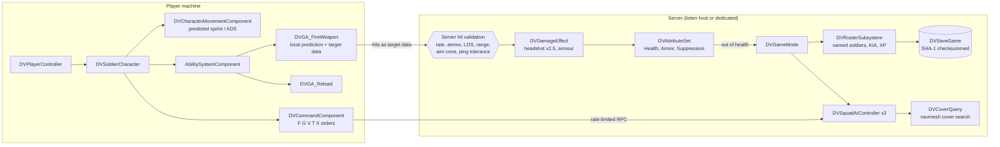

### A shot, from start to finish

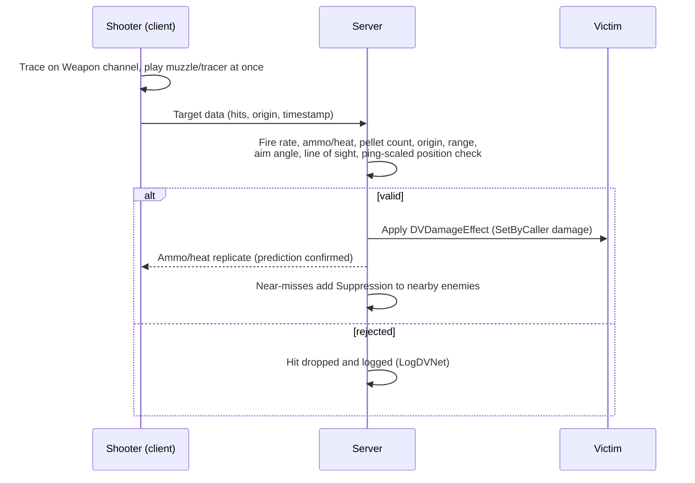

### Squad orders

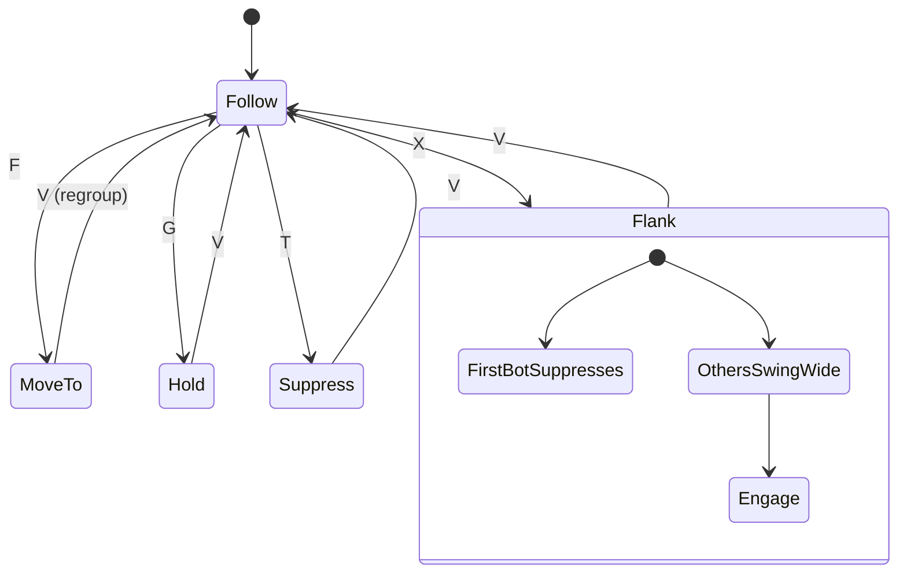

### Campaign attrition

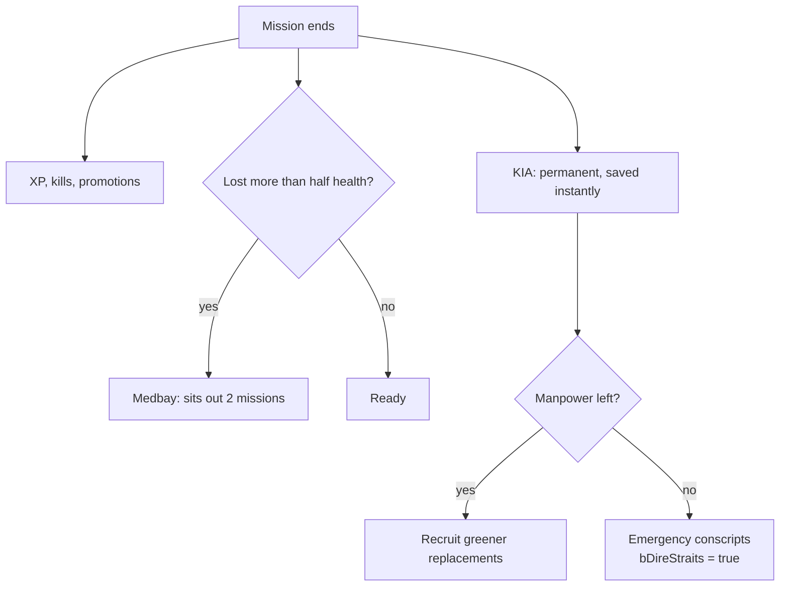

---

## Wiring up real art (in the editor)

- **Soldier:** make `BP_Soldier` from `DVSoldierCharacter`; set `Mesh` (with a physics asset for
  per-bone hits/headshots), `FirstPersonMesh`, anim blueprints. The grey-box body hides itself
  once a mesh is set. Use it as `DefaultPawnClass` and `SquadmateClass` on a `DVGameMode` child.
- **Weapons:** Data Asset > `DVWeaponData` per weapon (M9 Bastion, Kite, Halberd with
  `PelletsPerShot` 8, Longreach, Pulse Carbine with `bUsesHeat`). Assign mesh, muzzle socket,
  Niagara muzzle/tracer/impact, sound, montages. Grey-box rifle and tracers are used until then.
- **Enemies:** place soldiers with `TeamId = 2` (Hearthbound). Squad and player are `TeamId = 1`.

## Security and anti-cheat

- The server decides where everyone is (`ClientAuthorativePosition=false`). Sprinting and aiming down sights are predicted on the client, so they still feel instant.
- Every hit is re-validated on the server (see the sequence diagram); clients never apply damage.
- Calls from players to the server (remote procedure calls, or RPCs: fire, reload, lean, orders) are rate limited.
- Saves carry a checksum and are rejected if they've been edited. In co-op, only the host's save counts.
- EOS and Easy Anti-Cheat are set up as a config template in `Config/DefaultEngine.ini`. Fill in your own portal credentials to switch them on.

---

## Credits and originality

All the characters, places, factions, story, maps, sounds and code are original to this project. The worlds and
vehicles are built in code and Python from engine primitives. Characters use the UE5 template mannequins that ship
with the engine. The design references (Halo, Helldivers, Star Wars Outlaws, Red Dead Redemption 2 and others) are
studied for principles only; nothing is copied from them.
